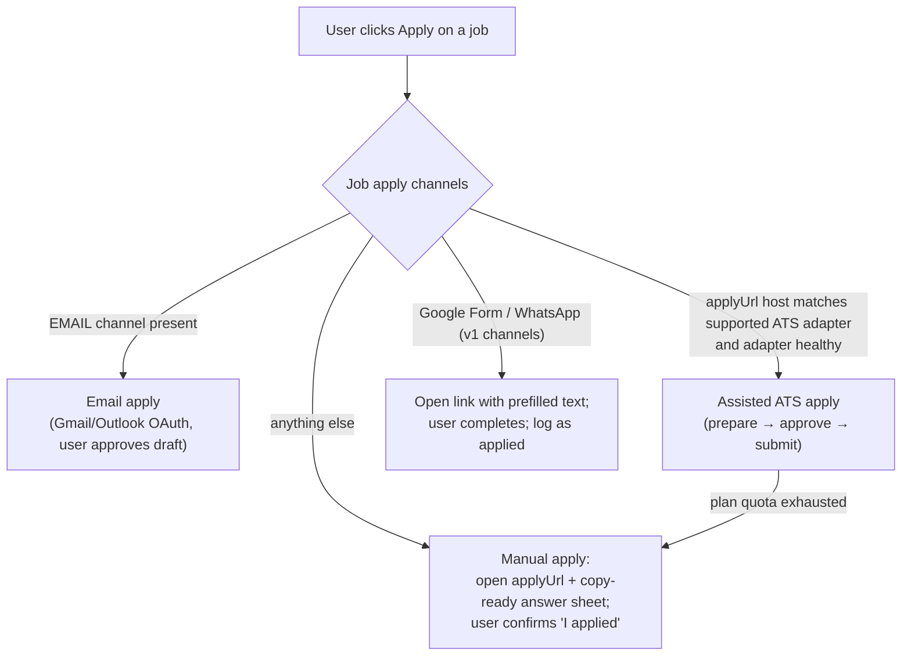
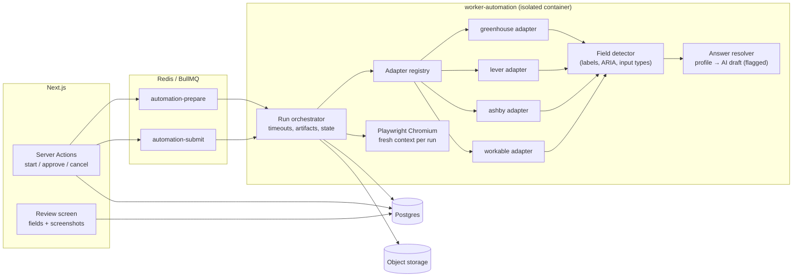

# Automation Design: Assisted Application Engine

> Scope: help a candidate apply faster **with their explicit, per-application approval**, using official channels where they exist and browser automation only on supported, permitted application forms. ADR-014.
>
> **Active profile: zero-cost (ADR-023).** There is no automation container. The orchestrator in §3 runs as a **local runner on the owner's PC** (`npm run automation:runner`). It polls Neon for `PREPARING`/`APPROVED` tasks belonging to the owner only, while it is running. Other beta users see "Apply manually" with the copy-ready answer sheet. All compliance rules in §1 and the two-phase approval flow are unchanged. AI-drafted answers use the `LlmProvider` (Gemini/Groq) with PII redaction.

## 1. Compliance rules (non-negotiable)

These are product requirements, enforced in code review by the `security-auditor` and `automation-engineer` agents:

1. **Prefer official channels.** If an employer offers an email address, an official API, or a standard ATS form, use that. Browser automation is a convenience layer for standard ATS forms, never a way around access controls.
2. **Respect platform terms, robots directives and rate limits.** Every adapter has a documented compliance review (`docs/guides/automation-adapter-review.md` template, created in M9). Domains are allowlisted per adapter; anything else goes to manual apply.
3. **Never bypass CAPTCHAs, MFA, bot challenges, login walls, or paywalls.** Detection of any of these stops the run (`BLOCKED`) and hands off to manual. No CAPTCHA-solving services, no stealth/fingerprint plugins, no residential proxies, no user-agent spoofing beyond the default Playwright Chromium UA plus an honest product identifier in `Sec-CH`/`User-Agent` suffix where allowed.
4. **No storage of job-site passwords.** The engine only fills public application forms that need no login. Sites requiring an account (Workday, Taleo, iCIMS candidate portals, LinkedIn Easy Apply, Indeed) are **manual-only**.
5. **Explicit authorisation per submission.** The user reviews the exact prepared payload (every field and attached file) and approves it; the approval is bound to a hash of that payload and expires after 24 h. Global "auto-submit everything" is not offered.
6. **Truthfulness.** Answers come from the user's profile or answers they have confirmed. AI-drafted answers (e.g. "Why do you want to work here?") are flagged, must be edited or explicitly accepted, and are never used for factual/legal questions (work authorisation, criminal record, disability, salary history, demographics: EEO fields are left for the user, default "decline to answer" only if the user set that preference).
7. **Encrypted secrets.** OAuth tokens for mailboxes use envelope encryption (ADR-015). Automation workers never receive mailbox tokens.
8. **Manual fallback for everything.** Every automated path has a "Apply manually" equivalent with copy-ready answers and the resume download.

## 2. Channel selection



## 3. Architecture



### 3.1 Worker isolation
- Separate container image (`mcr.microsoft.com/playwright` base, pinned version), separate deployment from `worker-general`.
- **One browser context per run**, no persistent profile, no cookies carried between users or runs; context closed in `finally`.
- Egress restricted (where the host supports it) to: allowlisted ATS domains, object storage, Postgres, Redis, Sentry. Downloads disabled; file chooser accepts only the resume file staged for this run in a per-run temp dir deleted afterwards.
- Hard limits: 120 s per page action chain, 5 min per run, max 2 concurrent runs per container, memory limit with restart.
- Workers receive only: task id → load task from DB → presigned GET for the specific resume version. No other user data.

### 3.2 Adapter interface

```ts
export interface AtsAdapter {
  readonly id: "greenhouse" | "lever" | "ashby" | "workable";
  readonly version: string;                                  // bump on any selector/flow change
  readonly allowedHosts: readonly RegExp[];                   // e.g. /^boards\.greenhouse\.io$/, /^job-boards\.greenhouse\.io$/
  readonly rateLimit: { perHostPerMinute: number };
  matches(applyUrl: URL): boolean;
  /** Navigate to the form; detect blockers; return a structured description of fields. */
  openForm(page: Page, applyUrl: URL): Promise<FormSnapshot | Blocked>;
  /** Fill fields from resolved answers; never clicks submit. */
  fill(page: Page, form: FormSnapshot, answers: ResolvedAnswers, files: StagedFiles): Promise<FillReport>;
  /** Click submit and verify a confirmation signal. Only called in SUBMIT phase. */
  submit(page: Page): Promise<SubmissionResult>;
}

type Blocked = { blocked: true; reason: "CAPTCHA" | "MFA" | "LOGIN_REQUIRED" | "BOT_CHALLENGE" | "FORM_UNAVAILABLE" | "UNSUPPORTED_LAYOUT" };
```

Adapters prefer **role/label-based locators** (`getByLabel`, `getByRole`) and stable `name`/`id` attributes documented per ATS; CSS-structure selectors are a last resort and must have a fixture test.

## 4. Two-phase workflow

### Phase A: PREPARE (no submission possible)
1. Load task, check: task status `PREPARING`, plan quota, adapter health (circuit open → `NEEDS_MANUAL`), host allowlist, per-host rate limit token.
2. Launch context, navigate to `applyUrl`, wait for network idle with timeout.
3. **Blocker detection** (before and after each step): reCAPTCHA/hCaptcha/Turnstile iframes or scripts, "verify you are human" pages, login forms, MFA prompts, HTTP 403/429. Any hit → `BLOCKED(reason)` → task `NEEDS_MANUAL`.
4. **Field detection:** adapter-known fields + generic detection (label text, `aria-label`, `placeholder`, input type, required flag, options for select/radio). Produces `FormSnapshot { fields: [{ key, label, type, required, options?, maxLength? }] }`.
5. **Answer resolution:** (a) deterministic mapping from profile (`first_name`, `email`, `phone`, `linkedin`, `location`, `resume` file, `cover_letter` from approved `ApplicationDocument`); (b) user's saved answer library (past confirmed answers keyed by normalised question text); (c) AI draft for open-ended questions only (`answer.formField` prompt, ≤ 150 words, flagged `aiDrafted`); (d) **unanswerable** required fields → mark `needsUserInput`.
6. Fill everything resolvable; attach resume; **do not click submit**.
7. Capture artifacts: full-page screenshot(s), a JSON snapshot of filled values, hash `preparedPayloadHash = sha256(canonicalJSON(fields + answers + fileHashes + adapterVersion))`.
8. Persist execution `SUCCEEDED (PREPARED)`, task → `AWAITING_APPROVAL`, `expiresAt = now + 24h`, notify user.

### Phase B: USER REVIEW (in the web app)
- Review screen shows every field with its answer (editable), flags (AI-drafted, needs input, EEO left blank), attached file name, screenshots, the job and employer.
- Consent checkbox text (versioned, stored in `UserConsent`/task): *"I have reviewed this application and authorise JobFinder to submit it on my behalf to {employer} via {ATS}."*
- Editing an answer re-computes the hash client-visible and server-side; approval is stored as `approvedPayloadHash` + `approvedAt` + `consentVersion`. Server action verifies the hash it computes from stored payload + edits equals the one the user approved.

### Phase C: SUBMIT
1. Preconditions: task `APPROVED`, not expired, `approvedPayloadHash` present, adapter version unchanged since prepare (else → re-prepare).
2. Fresh context, open form, re-run blocker detection, re-detect fields. **If the detected field set differs from the prepared snapshot** (added/removed required fields, changed options) → `NEEDS_MANUAL(FORM_CHANGED)`; never improvise.
3. Fill exactly the approved answers; compute the hash of what was actually filled; must equal `approvedPayloadHash`.
4. Submit once. Verification (adapter-specific, ≥ 1 required):
   - URL/route change to the ATS confirmation page;
   - confirmation text pattern ("Thank you for applying", "Application submitted");
   - optional: confirmation email detected later by mail sync (strengthens evidence).
5. Persist screenshot of confirmation, `confirmationEvidence`, task → `SUBMITTED`, upsert `JobApplication(stage=APPLIED, channel=ATS_AUTOMATION, appliedAt, resumeVersionId)`, `ApplicationStageChange(actor=AUTOMATION)`, usage record, audit log `automation.submitted`, notify user.
6. If no confirmation signal within timeout → `FAILED(UNVERIFIED_SUBMISSION)` and the user is told **"We could not confirm the submission. Check your email for a confirmation before re-trying"**. Never auto-retry an unverified submit (risk of duplicate applications).

## 5. Form field detection details

| Field class | Detection signals | Answer source |
|---|---|---|
| Identity (name, email, phone, location) | input type, autocomplete attr, label regex (multi-language list) | `UserProfile` / resume contact |
| Links (LinkedIn, GitHub, portfolio) | label regex, `type=url` | profile links |
| Resume / CV upload | `input[type=file]` with label `resume|cv` | staged `ResumeVersion` file (PDF preferred) |
| Cover letter (upload or textarea) | label regex | approved `ApplicationDocument` (COVER_LETTER) or skip if optional |
| Work authorisation / sponsorship | label regex (`authori[sz]ed`, `sponsor`, `visa`) | **profile answer only**, never AI |
| Salary expectation | label regex | profile setting only; if absent → needs user input |
| EEO / demographic | ATS-known section ids, label regex | user preference only (default: leave blank → needs user input if required) |
| Open-ended questions | textarea + question text | answer library → AI draft (flagged) |
| Unknown required field | anything unclassified | needs user input (blocks approval until answered) |

## 6. Cover-letter generation
- Prompt `coverLetter.generate` (versioned) with: candidate profile, job extraction, match strengths/gaps, user tone preference, length limit (default 220–300 words), language.
- Hard rules: no invented experience, employers, numbers or credentials; every claim must map to resume content (post-check: entities/years mentioned must appear in the profile; violations flagged in the editor).
- Saved as `ApplicationDocument(kind=COVER_LETTER, generatedByAi=true)`; user edits and approves (`approvedAt`) before use in email or automation.
- Counts toward plan quota (`UsageMetric.COVER_LETTER`).

## 7. Email apply (official channel, M8)
- Uses the user's connected mailbox (Gmail API / Graph `sendMail`), never a shared sender, so replies go to the user.
- Draft = template + approved cover letter + resume attachment. User approves each send (bulk send = approving a list of drafts, each visible).
- Per-account daily cap (default 50; v1 used 150 with Gmail SMTP: lower for new accounts to protect deliverability), ≥ 4 s spacing (v1 `MAIL_DELAY_MS`), recipient dedupe within 30 days with warning (v1 behaviour), unique index prevents double sends.
- Bounce/auth failures stop the batch for that account.

## 8. Retry & failure handling

| Failure | Phase | Retry policy | User-facing result |
|---|---|---|---|
| Network timeout / 5xx loading form | prepare | 2 retries, backoff 30 s → 2 min | transparent |
| Rate-limit token unavailable | both | delayed job (BullMQ delay) | "Queued" |
| CAPTCHA / MFA / login / bot challenge | both | **no retry** | NEEDS_MANUAL + reason + answer sheet |
| Selector not found / layout unsupported | prepare | none; adapter health −1 | NEEDS_MANUAL; alert if failure rate > 20% / 1 h (circuit opens) |
| Form changed between prepare and submit | submit | none | re-prepare offered (one click) |
| Submit clicked, no confirmation | submit | **never auto-retry** | FAILED(UNVERIFIED) with guidance |
| Submit click failed before click | submit | 1 retry (idempotent: nothing submitted) | transparent |
| Worker crash | either | BullMQ stalled job → prepare re-runs; submit marks `FAILED(INTERRUPTED)` unless evidence shows the click never happened (step log persisted *before* click) | guidance as above |

Circuit breaker per adapter: failure rate over a sliding window opens the circuit for 30 min → new tasks route to manual; admin dashboard shows adapter health.

## 9. Automation logs & artifacts
- `AutomationExecution.steps`: ordered `{ at, step, outcome, detail }` entries (e.g. `navigate`, `detect_blockers`, `detect_fields`, `fill:email`, `attach_resume`, `screenshot`, `pre_submit_hash_check`, `submit_click`, `verify_confirmation`). Values filled are **not** logged here (only field keys); the payload lives in the task, artifacts in storage.
- Artifacts: screenshots (PNG, PII → private bucket, 90-day retention), optional HAR disabled by default (contains PII).
- Metrics: runs by adapter × outcome, blocked-reason distribution, p95 duration, verification rate. Exposed on the admin page and Sentry.
- Audit: `automation.prepared`, `automation.approved` (with hash), `automation.submitted`, `automation.cancelled`.

## 10. Testing strategy (summary; see TESTING_STRATEGY §5)
- **Fixture forms:** static HTML replicas of each ATS form layout served by a local server in CI (captured with permission or hand-built from public markup). Tests cover field detection, filling, blocker detection (fixture pages containing CAPTCHA iframes must produce `BLOCKED`), and hash equality.
- **Never** run automated submissions against real employer postings in CI. Manual smoke tests against an owned test posting (e.g. an employer sandbox board we control) before enabling an adapter version.
- Contract tests per adapter version; adapter version bump requires all fixture tests green.

## 11. Rollout
1. M9a: prepare-only ("Fill for me" → we show prefilled answers + screenshots; user submits manually on the site). Zero submission risk, validates detection quality.
2. M9b: submit phase for Greenhouse + Lever behind a feature flag, Premium plan, owner/beta users.
3. M9c: Ashby + Workable; general availability after ≥ 95% verified-submission rate over 200 runs and zero duplicate submissions.
