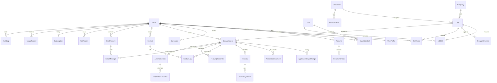

# Database Design

> PostgreSQL 16+ (Neon) · Prisma ORM (ADR-004, proposed) · extensions: `vector` (pgvector), `pg_trgm`, `citext`
> **Active profile: zero-cost (ADR-023).** Resume bytes live in `ResumeFile` (bytea), background work in `BackgroundJob`, rate limits in `RateLimitBucket`, embeddings are `halfvec(768)`, and the storage budget in ADR-023 applies (Neon Free ≈ 0.5 GB).
> The schema below is a **design**, not yet applied. It will be created in `prisma/schema.prisma` during Milestones 0–1 and grown per milestone (§9).

## 1. Design principles

1. **Tenant key everywhere.** Every user-owned table has a non-null `userId` (FK → `User`, `onDelete: Cascade`) even when derivable through a parent. This allows a single-column scoping predicate on every query, cheap composite indexes beginning with `userId`, and future Row-Level Security (ADR-006).
2. **Global catalog is separate.** `Company`, `Job`, `JobSource`, `JobSourceRun`, `JobSkill`, `JobApplyChannel`, `Skill` are shared and carry no `userId`. The exception is user-submitted private jobs (`Job.visibility = PRIVATE`, `ownerUserId`).
3. **IDs:** UUIDv7 (`@default(uuid(7)) @db.Uuid`): time-ordered for index locality, non-enumerable. Better Auth is configured to generate UUIDv7 for its tables.
4. **Timestamps:** `timestamptz` everywhere (`@db.Timestamptz(6)`), `createdAt`/`updatedAt` on mutable tables. Business times are stored in UTC; display timezone comes from `User.timezone`.
5. **State machines as enums** with guarded transitions in services (no free-text statuses).
6. **History, not overwrites**, where users care about history: `ResumeVersion`, `ApplicationStageChange`, `AutomationExecution`, `AuditLog`.
7. **JSONB only for** semi-structured payloads that are read whole and not filtered on (parsed resume, score breakdowns, automation steps). Anything filtered or joined is a column.
8. **Money** as integer minor units + ISO currency code; **salary** as integer annual/monthly amounts in currency units with `salaryPeriod`.
9. **Soft delete** only where needed for undo/retention (`JobApplication.archivedAt`, `User.deletionRequestedAt`); everything else is hard-deleted, which GDPR erasure requires.

## 2. Entity evaluation

The brief listed candidate entities. Each was evaluated rather than adopted blindly:

| Entity | Verdict | Reasoning |
|---|---|---|
| User | **Keep** | Auth identity (Better Auth core table), role, locale/timezone, deletion state |
| (Session, Account, Verification) | **Add** | Required by Better Auth; `Account` holds OAuth *sign-in* links and the password hash |
| UserProfile | **Keep (1:1)** | Job-search preferences change often and are matching inputs; separated from auth identity so auth tables stay library-owned |
| Resume | **Keep** | A user may keep several targeted resumes ("Frontend", "Fullstack"); `isPrimary` drives default matching |
| ResumeVersion | **Keep** | Each upload is immutable: file + extracted text + parsed JSON + parser/prompt version. Applications reference the exact version sent |
| CandidateSkill | **Keep** | Normalised, user-editable skill list; the core matching input. Derived from the active resume version and user edits |
| Skill (taxonomy) | **Add** | Without canonical skills and aliases, "React.js" ≠ "ReactJS" and keyword matching fails. Global table seeded from an open taxonomy (e.g. ESCO / O*NET tech skills) + curated aliases |
| Work experience / education | **Not a table** | Read whole, never filtered relationally → `ResumeVersion.parsed` JSON. Derived numbers (total years, seniority) are columns on `UserProfile` |
| Company | **Keep** | Dedupe anchor for jobs, exclusion lists, contacts |
| JobSource | **Keep** | Adapter config, schedule, compliance status (ADR-011) |
| JobSourceRun | **Add** | Ingest observability and idempotency (evolution of v1 `fetch_runs`) |
| Job | **Keep** | Global catalog row with deterministic + AI-parsed fields and embedding |
| JobSkill | **Add** | Required/preferred skills per job; matched against CandidateSkill in SQL |
| JobApplyChannel | **Add** | v1's `job_contacts` (emails/phones/forms extracted from posts) generalised; drives apply-channel choice |
| JobMatch | **Keep** | Per-user computed score with breakdown, explanation and gaps; regenerable, versioned by `scoringVersion` |
| SavedJob | **Keep (thin)** | Explicit bookmark with a note; independent of whether a match exists (users can save private/manual jobs). Dismissal is *not* here: it is match feedback (`JobMatch.status = DISMISSED`) |
| JobApplication | **Keep** | The tracker card |
| ApplicationStage | **Replace** with enum + `ApplicationStageChange` | A lookup table only pays off with user-defined pipelines (deferred). The enum keeps analytics consistent; the history table gives the audit trail and time-in-stage metrics |
| ApplicationDocument | **Add** | Cover letters / answer sets, AI-generated or edited, with approval timestamp; referenced by email and automation |
| Interview | **Keep** | Rounds, schedule, outcome |
| InterviewQuestion | **Keep** | Prep questions (AI or user) with answer notes; per-interview ordering |
| Contact | **Add** | Recruiters / hiring managers per user; `ContactLog` needs a person to point at |
| ContactLog | **Keep** | Interaction timeline (emails, calls, notes) |
| FollowUpReminder | **Keep** | Scheduled nudges; `(status, dueAt)` index drives the reminder scheduler |
| EmailAccount | **Keep** | Connected mailbox (OAuth), encrypted tokens, send limits |
| EmailMessage | **Add** | Outbound/inbound application mail; idempotency and double-send protection (v1's partial unique index) |
| MessageTemplate | **Add** | v1 `email_templates`, now per user |
| AutomationTask | **Keep** | One user-approved intent to apply via an adapter; owns the approval record |
| AutomationExecution | **Keep** | Each prepare/submit attempt with steps, artifacts, errors |
| Notification | **Keep** | In-app inbox + email digest source |
| Subscription | **Keep** | Billing state mirrored from provider webhooks (ADR-016) |
| UsageRecord | **Keep** | Metering for quotas and AI cost (model, tokens, prompt version) |
| AuditLog | **Add** | Security-relevant actions (login, token connect, submissions, exports, admin access) |
| UserConsent | **Add** | Versioned acceptance of ToS, privacy policy, automation authorisation (GDPR accountability) |
| WebhookEvent | **Add** | Idempotent webhook processing (provider + event id) |
| OutboxEvent | **Add in M10** | Transactional outbox (ADR-007); in the zero-cost profile the outbox *is* `BackgroundJob` (enqueue inside the same transaction) |
| BackgroundJob | **Add (zero-cost)** | Postgres job queue replacing BullMQ (ADR-023): claimed with `SKIP LOCKED`, retries via `attempts`/`notBefore` |
| RateLimitBucket | **Add (zero-cost)** | Postgres store for `rate-limiter-flexible` (ADR-017/023) |
| ResumeFile | **Add (zero-cost)** | Resume bytes in Postgres (v1 `cv_file` approach) separated from `ResumeVersion` so metadata queries never load file bytes |
| Organization / Team | **Defer** | No B2B requirement yet (ADR-006) |

## 3. Entity-relationship overview



## 4. Status state machines

```
ResumeVersion.status:   UPLOADED → PROCESSING → PARSED | FAILED      (FAILED → PROCESSING on retry)
Job.status:             NEW → ACTIVE → EXPIRED | REMOVED              (parseStatus: PENDING → PARSED | FAILED)
JobMatch.status:        NEW → SEEN → DISMISSED | APPLIED               (recomputation never resets DISMISSED/APPLIED)
JobApplication.stage:   DRAFT → APPLIED → SCREENING → INTERVIEWING → OFFER → ACCEPTED
                        any active stage → REJECTED | WITHDRAWN | GHOSTED   (moves back allowed, all recorded)
EmailMessage.status:    QUEUED → SENDING → SENT | FAILED ; inbound: RECEIVED
AutomationTask.status:  PREPARING → AWAITING_APPROVAL → APPROVED → SUBMITTING → SUBMITTED
                        PREPARING|SUBMITTING → NEEDS_MANUAL | FAILED ; AWAITING_APPROVAL → CANCELLED | EXPIRED
FollowUpReminder.status: PENDING → NOTIFIED → DONE | SNOOZED(→PENDING) | CANCELLED
Subscription.status:    TRIALING | ACTIVE | PAST_DUE | CANCELED | INCOMPLETE  (provider-driven)
```

## 5. Proposed Prisma schema

> Syntax targets the Prisma 7 line (`prisma-client` generator, config in `prisma.config.ts`). Verify against installed docs at M0. Vector columns use `Unsupported` and are queried with raw SQL (§7).

```prisma
generator client {
  provider = "prisma-client"
  output   = "../src/generated/prisma"
}

datasource db {
  provider   = "postgresql"
  extensions = [vector, pg_trgm, citext]
}

// ───────────────────────────── Enums ─────────────────────────────

enum Role { USER ADMIN }
enum PlanTier { FREE PRO PREMIUM }
enum SubscriptionStatus { TRIALING ACTIVE PAST_DUE CANCELED INCOMPLETE }
enum WorkMode { REMOTE HYBRID ONSITE }
enum EmploymentType { FULL_TIME PART_TIME CONTRACT INTERNSHIP TEMPORARY FREELANCE }
enum SeniorityLevel { INTERN JUNIOR MID SENIOR LEAD PRINCIPAL EXECUTIVE }
enum SalaryPeriod { HOUR MONTH YEAR }
enum ResumeFileType { PDF DOCX }
enum ResumeStatus { UPLOADED PROCESSING PARSED FAILED }
enum SkillCategory { LANGUAGE FRAMEWORK TOOL PLATFORM DATABASE CLOUD METHODOLOGY SOFT_SKILL DOMAIN OTHER }
enum SkillSource { RESUME USER INFERRED }
enum SkillImportance { REQUIRED PREFERRED }
enum JobSourceKind { ATS_BOARD_API AGGREGATOR_API RSS USER_SUBMITTED APIFY_LEGACY }
enum ComplianceStatus { PENDING_REVIEW APPROVED REJECTED }
enum SourceRunStatus { RUNNING SUCCEEDED PARTIAL FAILED }
enum JobStatus { NEW ACTIVE EXPIRED REMOVED }
enum ParseStatus { PENDING PARSED FAILED }
enum Visibility { PUBLIC PRIVATE }
enum ApplyChannelType { EMAIL PHONE GOOGLE_FORM ATS_URL OTHER_URL }
enum MatchStatus { NEW SEEN DISMISSED APPLIED }
enum ApplicationStage { DRAFT APPLIED SCREENING INTERVIEWING OFFER ACCEPTED REJECTED WITHDRAWN GHOSTED }
enum ApplicationChannel { EMAIL ATS_AUTOMATION MANUAL_EXTERNAL WHATSAPP GOOGLE_FORM REFERRAL }
enum ActorType { USER SYSTEM AUTOMATION ADMIN }
enum DocumentKind { COVER_LETTER ANSWER_SET }
enum InterviewType { PHONE_SCREEN VIDEO ONSITE TECHNICAL TAKE_HOME BEHAVIORAL PANEL FINAL OTHER }
enum InterviewOutcome { PENDING PASSED FAILED CANCELLED NO_SHOW }
enum QuestionSource { AI USER RECRUITER }
enum ContactLogType { EMAIL_SENT EMAIL_RECEIVED CALL MESSAGE MEETING NOTE }
enum ReminderStatus { PENDING NOTIFIED DONE SNOOZED CANCELLED }
enum MailProvider { GMAIL MICROSOFT }
enum EmailAccountStatus { ACTIVE REAUTH_REQUIRED DISCONNECTED }
enum MessageDirection { OUTBOUND INBOUND }
enum MessageStatus { QUEUED SENDING SENT FAILED RECEIVED }
enum AutomationTaskStatus { PREPARING AWAITING_APPROVAL APPROVED SUBMITTING SUBMITTED NEEDS_MANUAL FAILED CANCELLED EXPIRED }
enum ExecutionPhase { PREPARE SUBMIT }
enum ExecutionStatus { RUNNING SUCCEEDED BLOCKED FAILED }
enum NotificationType { RESUME_PARSED NEW_MATCHES AUTOMATION_READY AUTOMATION_RESULT REMINDER_DUE INTERVIEW_UPCOMING EMAIL_REPLY ACCOUNT_ACTION BILLING SYSTEM }
enum UsageMetric { AI_TOKENS RESUME_PARSE MATCH_EXPLANATION COVER_LETTER INTERVIEW_QUESTIONS AUTOMATION_RUN EMAIL_SENT EMBEDDING }
enum ConsentKind { TERMS PRIVACY AUTOMATION_AUTHORIZATION MARKETING }

// ───────────────────── Identity (Better Auth core) ─────────────────────

model User {
  id                  String    @id @default(uuid(7)) @db.Uuid
  name                String
  email               String    @unique @db.Citext
  emailVerified       Boolean   @default(false)
  image               String?
  role                Role      @default(USER)
  timezone            String    @default("UTC")
  locale              String    @default("en")
  deletionRequestedAt DateTime? @db.Timestamptz(6)
  createdAt           DateTime  @default(now()) @db.Timestamptz(6)
  updatedAt           DateTime  @updatedAt @db.Timestamptz(6)

  sessions          Session[]
  accounts          Account[]
  profile           UserProfile?
  resumes           Resume[]
  resumeVersions    ResumeVersion[]
  resumeFiles       ResumeFile[]
  skills            CandidateSkill[]
  matches           JobMatch[]
  savedJobs         SavedJob[]
  applications      JobApplication[]
  stageChanges      ApplicationStageChange[]
  documents         ApplicationDocument[]
  interviews        Interview[]
  interviewQs       InterviewQuestion[]
  contacts          Contact[]
  contactLogs       ContactLog[]
  reminders         FollowUpReminder[]
  emailAccounts     EmailAccount[]
  emailMessages     EmailMessage[]
  templates         MessageTemplate[]
  automationTasks   AutomationTask[]
  automationRuns    AutomationExecution[]
  notifications     Notification[]
  subscription      Subscription?
  usage             UsageRecord[]
  consents          UserConsent[]
  auditLogs         AuditLog[]
  privateJobs       Job[]     @relation("PrivateJobOwner")

  @@map("user")
}

model Session {
  id        String   @id @default(uuid(7)) @db.Uuid
  userId    String   @db.Uuid
  token     String   @unique
  expiresAt DateTime @db.Timestamptz(6)
  ipAddress String?
  userAgent String?
  createdAt DateTime @default(now()) @db.Timestamptz(6)
  updatedAt DateTime @updatedAt @db.Timestamptz(6)
  user      User     @relation(fields: [userId], references: [id], onDelete: Cascade)

  @@index([userId])
  @@map("session")
}

/// OAuth sign-in links + credential (password hash). NOT mailbox connections (see EmailAccount).
model Account {
  id                    String    @id @default(uuid(7)) @db.Uuid
  userId                String    @db.Uuid
  accountId             String
  providerId            String
  accessToken           String?
  refreshToken          String?
  idToken               String?
  accessTokenExpiresAt  DateTime? @db.Timestamptz(6)
  refreshTokenExpiresAt DateTime? @db.Timestamptz(6)
  scope                 String?
  password              String?
  createdAt             DateTime  @default(now()) @db.Timestamptz(6)
  updatedAt             DateTime  @updatedAt @db.Timestamptz(6)
  user                  User      @relation(fields: [userId], references: [id], onDelete: Cascade)

  @@unique([providerId, accountId])
  @@index([userId])
  @@map("account")
}

model Verification {
  id         String   @id @default(uuid(7)) @db.Uuid
  identifier String
  value      String
  expiresAt  DateTime @db.Timestamptz(6)
  createdAt  DateTime @default(now()) @db.Timestamptz(6)
  updatedAt  DateTime @updatedAt @db.Timestamptz(6)

  @@index([identifier])
  @@map("verification")
}

// ───────────────────────────── Candidate ─────────────────────────────

model UserProfile {
  userId                String           @id @db.Uuid
  headline              String?
  summary               String?
  targetTitles          String[]
  targetLocations       Json             @default("[]") /// [{city, region, countryCode, radiusKm}]
  workModes             WorkMode[]
  employmentTypes       EmploymentType[]
  seniority             SeniorityLevel?
  totalYearsExperience  Decimal?         @db.Decimal(4, 1)
  salaryMin             Int?
  salaryCurrency        String?          @db.Char(3)
  salaryPeriod          SalaryPeriod?
  willingToRelocate     Boolean          @default(false)
  workAuthorization     Json             @default("[]") /// [{countryCode, status}]
  excludedCompanyIds    String[]         @db.Uuid
  dealbreakers          Json             @default("{}")
  notificationPrefs     Json             @default("{}")
  primaryResumeId       String?          @unique @db.Uuid
  embedding             Unsupported("halfvec(768)")?
  embeddingModel        String?
  embeddingUpdatedAt    DateTime?        @db.Timestamptz(6)
  lastMatchedAt         DateTime?        @db.Timestamptz(6)
  onboardingCompletedAt DateTime?        @db.Timestamptz(6)
  updatedAt             DateTime         @updatedAt @db.Timestamptz(6)

  user          User    @relation(fields: [userId], references: [id], onDelete: Cascade)
  primaryResume Resume? @relation("PrimaryResume", fields: [primaryResumeId], references: [id], onDelete: SetNull)
}

model Resume {
  id              String          @id @default(uuid(7)) @db.Uuid
  userId          String          @db.Uuid
  label           String
  currentVersionId String?        @unique @db.Uuid
  createdAt       DateTime        @default(now()) @db.Timestamptz(6)
  updatedAt       DateTime        @updatedAt @db.Timestamptz(6)

  user            User            @relation(fields: [userId], references: [id], onDelete: Cascade)
  versions        ResumeVersion[] @relation("ResumeVersions")
  currentVersion  ResumeVersion?  @relation("CurrentVersion", fields: [currentVersionId], references: [id], onDelete: SetNull)
  primaryFor      UserProfile?    @relation("PrimaryResume")

  @@index([userId])
}

model ResumeVersion {
  id             String         @id @default(uuid(7)) @db.Uuid
  resumeId       String         @db.Uuid
  userId         String         @db.Uuid
  versionNumber  Int
  storageKey     String?        @unique /// scale profile (object storage); null in zero-cost profile (bytes in ResumeFile)
  fileName       String
  fileType       ResumeFileType
  sizeBytes      Int
  sha256         String         @db.Char(64)
  status         ResumeStatus   @default(UPLOADED)
  extractedText  String?        /// PII. Never logged, never sent to analytics.
  parsed         Json?          /// ResumeExtraction (Zod schema in src/server/ai/prompts/resume.extract)
  parserVersion  String?
  promptVersion  String?
  parseError     String?
  parsedAt       DateTime?      @db.Timestamptz(6)
  createdAt      DateTime       @default(now()) @db.Timestamptz(6)

  resume         Resume         @relation("ResumeVersions", fields: [resumeId], references: [id], onDelete: Cascade)
  user           User           @relation(fields: [userId], references: [id], onDelete: Cascade)
  currentOf      Resume?        @relation("CurrentVersion")
  file           ResumeFile?
  skills         CandidateSkill[]
  applications   JobApplication[]

  @@unique([resumeId, versionNumber])
  @@index([userId, createdAt(sort: Desc)])
  @@index([status, createdAt])
}

/// Zero-cost profile: file bytes stored in Postgres (ADR-023). Never selected by list queries.
model ResumeFile {
  resumeVersionId String        @id @db.Uuid
  userId          String        @db.Uuid
  mimeType        String
  data            Bytes         /// ≤ 4 MB, validated before insert
  createdAt       DateTime      @default(now()) @db.Timestamptz(6)
  resumeVersion   ResumeVersion @relation(fields: [resumeVersionId], references: [id], onDelete: Cascade)
  user            User          @relation(fields: [userId], references: [id], onDelete: Cascade)

  @@index([userId])
}

model Skill {
  id         String          @id @default(uuid(7)) @db.Uuid
  slug       String          @unique
  name       String
  category   SkillCategory
  aliases    String[]
  parentId   String?         @db.Uuid
  parent     Skill?          @relation("SkillHierarchy", fields: [parentId], references: [id], onDelete: SetNull)
  children   Skill[]         @relation("SkillHierarchy")
  candidates CandidateSkill[]
  jobs       JobSkill[]

  @@index([name]) // + GIN trigram index in migration SQL (§6)
}

model CandidateSkill {
  id               String       @id @default(uuid(7)) @db.Uuid
  userId           String       @db.Uuid
  skillId          String       @db.Uuid
  source           SkillSource
  yearsExperience  Decimal?     @db.Decimal(4, 1)
  lastUsedYear     Int?
  evidence         String?      /// short quote from the resume supporting the skill
  resumeVersionId  String?      @db.Uuid
  confirmedByUser  Boolean      @default(false)
  hidden           Boolean      @default(false)
  updatedAt        DateTime     @updatedAt @db.Timestamptz(6)

  user             User         @relation(fields: [userId], references: [id], onDelete: Cascade)
  skill            Skill        @relation(fields: [skillId], references: [id], onDelete: Restrict)
  resumeVersion    ResumeVersion? @relation(fields: [resumeVersionId], references: [id], onDelete: SetNull)

  @@unique([userId, skillId])
  @@index([skillId])
}

// ───────────────────────────── Catalog ─────────────────────────────

model Company {
  id             String    @id @default(uuid(7)) @db.Uuid
  name           String
  normalizedName String
  domain         String?   @unique
  websiteUrl     String?
  logoUrl        String?
  industry       String?
  sizeRange      String?
  hqCountryCode  String?   @db.Char(2)
  createdAt      DateTime  @default(now()) @db.Timestamptz(6)
  updatedAt      DateTime  @updatedAt @db.Timestamptz(6)
  jobs           Job[]
  contacts       Contact[]

  @@index([normalizedName])
}

model JobSource {
  id                 String           @id @default(uuid(7)) @db.Uuid
  kind               JobSourceKind
  adapter            String           /// e.g. "greenhouse", "lever", "adzuna", "apify-linkedin"
  name               String
  config             Json             /// non-secret adapter config (board tokens, queries). Secrets live in env.
  enabled            Boolean          @default(false)
  complianceStatus   ComplianceStatus @default(PENDING_REVIEW)
  termsReviewedAt    DateTime?        @db.Timestamptz(6)
  termsNotes         String?
  schedule           String?          /// cron expression
  rateLimitPerMinute Int              @default(30)
  cursor             Json?
  lastRunAt          DateTime?        @db.Timestamptz(6)
  createdAt          DateTime         @default(now()) @db.Timestamptz(6)
  updatedAt          DateTime         @updatedAt @db.Timestamptz(6)
  jobs               Job[]
  runs               JobSourceRun[]

  @@unique([adapter, name])
}

model JobSourceRun {
  id             String          @id @default(uuid(7)) @db.Uuid
  sourceId       String          @db.Uuid
  trigger        String          /// "schedule" | "manual" | "webhook"
  status         SourceRunStatus @default(RUNNING)
  externalRunId  String?         @unique
  fetchedCount   Int             @default(0)
  insertedCount  Int             @default(0)
  duplicateCount Int             @default(0)
  skippedCount   Int             @default(0)
  errorCount     Int             @default(0)
  error          String?
  startedAt      DateTime        @default(now()) @db.Timestamptz(6)
  finishedAt     DateTime?       @db.Timestamptz(6)
  source         JobSource       @relation(fields: [sourceId], references: [id], onDelete: Cascade)

  @@index([sourceId, startedAt(sort: Desc)])
  @@index([status, startedAt])
}

model Job {
  id                 String          @id @default(uuid(7)) @db.Uuid
  companyId          String?         @db.Uuid
  sourceId           String?         @db.Uuid
  externalId         String?
  dedupeHash         String          @unique
  canonicalJobId     String?         @db.Uuid /// set when detected as duplicate of another job
  visibility         Visibility      @default(PUBLIC)
  ownerUserId        String?         @db.Uuid /// only for PRIVATE user-submitted jobs
  title              String
  normalizedTitle    String
  description        String
  sourceUrl          String?
  applyUrl           String?
  atsProvider        String?         /// detected: greenhouse | lever | ashby | workable | …
  locationText       String?
  city               String?
  region             String?
  countryCode        String?         @db.Char(2)
  workMode           WorkMode?
  employmentType     EmploymentType?
  seniority          SeniorityLevel?
  minYearsExperience Decimal?        @db.Decimal(4, 1)
  salaryMin          Int?
  salaryMax          Int?
  salaryCurrency     String?         @db.Char(3)
  salaryPeriod       SalaryPeriod?
  postedAt           DateTime?       @db.Timestamptz(6)
  validThrough       DateTime?       @db.Timestamptz(6)
  firstSeenAt        DateTime        @default(now()) @db.Timestamptz(6)
  lastSeenAt         DateTime        @default(now()) @db.Timestamptz(6)
  status             JobStatus       @default(NEW)
  parseStatus        ParseStatus     @default(PENDING)
  parsed             Json?           /// JobExtraction (responsibilities, requirements, benefits…)
  parserVersion      String?
  embedding          Unsupported("halfvec(768)")?
  embeddingModel     String?
  raw                Json?           /// zero-cost: not stored (or ≤ 7 days); scale: trimmed, purged after 30 days (§8)
  createdAt          DateTime        @default(now()) @db.Timestamptz(6)
  updatedAt          DateTime        @updatedAt @db.Timestamptz(6)

  company            Company?        @relation(fields: [companyId], references: [id], onDelete: SetNull)
  source             JobSource?      @relation(fields: [sourceId], references: [id], onDelete: SetNull)
  canonical          Job?            @relation("JobDuplicates", fields: [canonicalJobId], references: [id], onDelete: SetNull)
  duplicates         Job[]           @relation("JobDuplicates")
  owner              User?           @relation("PrivateJobOwner", fields: [ownerUserId], references: [id], onDelete: Cascade)
  skills             JobSkill[]
  applyChannels      JobApplyChannel[]
  matches            JobMatch[]
  savedBy            SavedJob[]
  applications       JobApplication[]
  automationTasks    AutomationTask[]

  @@unique([sourceId, externalId])
  @@index([status, postedAt(sort: Desc)])
  @@index([companyId])
  @@index([countryCode, workMode, status])
  @@index([parseStatus, createdAt])
  @@index([ownerUserId])
}

model JobSkill {
  jobId      String          @db.Uuid
  skillId    String          @db.Uuid
  importance SkillImportance
  minYears   Decimal?        @db.Decimal(4, 1)
  job        Job             @relation(fields: [jobId], references: [id], onDelete: Cascade)
  skill      Skill           @relation(fields: [skillId], references: [id], onDelete: Restrict)

  @@id([jobId, skillId])
  @@index([skillId, importance])
}

model JobApplyChannel {
  id         String           @id @default(uuid(7)) @db.Uuid
  jobId      String           @db.Uuid
  type       ApplyChannelType
  value      String
  normalized String
  job        Job              @relation(fields: [jobId], references: [id], onDelete: Cascade)

  @@unique([jobId, type, normalized])
  @@index([type, normalized])
}

// ───────────────────────────── Matching ─────────────────────────────

model JobMatch {
  id              String      @id @default(uuid(7)) @db.Uuid
  userId          String      @db.Uuid
  jobId           String      @db.Uuid
  scoringVersion  String
  score           Int         /// 0–100 final
  baseScore       Int         /// deterministic component
  llmAdjustment   Int?        /// bounded [-10, +10]
  breakdown       Json        /// per-component scores + weights (AI_MATCHING_DESIGN §6)
  missingSkills   Json        @default("[]")
  explanation     Json?       /// {summary, strengths[], gaps[], evidence[]}
  degraded        Boolean     @default(false)
  status          MatchStatus @default(NEW)
  dismissedReason String?
  computedAt      DateTime    @default(now()) @db.Timestamptz(6)
  explainedAt     DateTime?   @db.Timestamptz(6)
  user            User        @relation(fields: [userId], references: [id], onDelete: Cascade)
  job             Job         @relation(fields: [jobId], references: [id], onDelete: Cascade)

  @@unique([userId, jobId])
  @@index([userId, status, score(sort: Desc)])
  @@index([userId, computedAt(sort: Desc)])
  @@index([jobId])
}

model SavedJob {
  userId    String   @db.Uuid
  jobId     String   @db.Uuid
  note      String?
  createdAt DateTime @default(now()) @db.Timestamptz(6)
  user      User     @relation(fields: [userId], references: [id], onDelete: Cascade)
  job       Job      @relation(fields: [jobId], references: [id], onDelete: Cascade)

  @@id([userId, jobId])
  @@index([userId, createdAt(sort: Desc)])
}

// ───────────────────────── Application tracking ─────────────────────────

model JobApplication {
  id               String             @id @default(uuid(7)) @db.Uuid
  userId           String             @db.Uuid
  jobId            String             @db.Uuid
  stage            ApplicationStage   @default(DRAFT)
  channel          ApplicationChannel?
  resumeVersionId  String?            @db.Uuid
  matchScoreAtApply Int?
  appliedAt        DateTime?          @db.Timestamptz(6)
  boardPosition    String             @default("m") /// fractional index (LexoRank-style) for Kanban ordering
  priority         Int                @default(0)
  notes            String?
  lastActivityAt   DateTime           @default(now()) @db.Timestamptz(6)
  archivedAt       DateTime?          @db.Timestamptz(6)
  createdAt        DateTime           @default(now()) @db.Timestamptz(6)
  updatedAt        DateTime           @updatedAt @db.Timestamptz(6)

  user             User               @relation(fields: [userId], references: [id], onDelete: Cascade)
  job              Job                @relation(fields: [jobId], references: [id], onDelete: Restrict)
  resumeVersion    ResumeVersion?     @relation(fields: [resumeVersionId], references: [id], onDelete: SetNull)
  stageChanges     ApplicationStageChange[]
  documents        ApplicationDocument[]
  interviews       Interview[]
  contactLogs      ContactLog[]
  reminders        FollowUpReminder[]
  emailMessages    EmailMessage[]
  automationTasks  AutomationTask[]

  @@unique([userId, jobId])
  @@index([userId, stage, boardPosition])
  @@index([userId, lastActivityAt(sort: Desc)])
}

model ApplicationStageChange {
  id            String            @id @default(uuid(7)) @db.Uuid
  userId        String            @db.Uuid
  applicationId String            @db.Uuid
  fromStage     ApplicationStage?
  toStage       ApplicationStage
  actorType     ActorType
  note          String?
  changedAt     DateTime          @default(now()) @db.Timestamptz(6)
  user          User              @relation(fields: [userId], references: [id], onDelete: Cascade)
  application   JobApplication    @relation(fields: [applicationId], references: [id], onDelete: Cascade)

  @@index([applicationId, changedAt])
  @@index([userId, changedAt(sort: Desc)])
}

model ApplicationDocument {
  id            String          @id @default(uuid(7)) @db.Uuid
  userId        String          @db.Uuid
  applicationId String?         @db.Uuid
  kind          DocumentKind
  content       String          /// cover letter text, or JSON-encoded answer set for ANSWER_SET
  generatedByAi Boolean         @default(false)
  promptVersion String?
  approvedAt    DateTime?       @db.Timestamptz(6)
  createdAt     DateTime        @default(now()) @db.Timestamptz(6)
  updatedAt     DateTime        @updatedAt @db.Timestamptz(6)
  user          User            @relation(fields: [userId], references: [id], onDelete: Cascade)
  application   JobApplication? @relation(fields: [applicationId], references: [id], onDelete: Cascade)

  @@index([userId, applicationId])
}

model Interview {
  id              String           @id @default(uuid(7)) @db.Uuid
  userId          String           @db.Uuid
  applicationId   String           @db.Uuid
  round           Int              @default(1)
  type            InterviewType
  scheduledAt     DateTime?        @db.Timestamptz(6)
  durationMinutes Int?
  location        String?
  meetingUrl      String?
  interviewers    Json             @default("[]")
  outcome         InterviewOutcome @default(PENDING)
  notes           String?
  createdAt       DateTime         @default(now()) @db.Timestamptz(6)
  updatedAt       DateTime         @updatedAt @db.Timestamptz(6)
  user            User             @relation(fields: [userId], references: [id], onDelete: Cascade)
  application     JobApplication   @relation(fields: [applicationId], references: [id], onDelete: Cascade)
  questions       InterviewQuestion[]
  reminders       FollowUpReminder[]

  @@index([userId, scheduledAt])
  @@index([applicationId])
}

model InterviewQuestion {
  id          String         @id @default(uuid(7)) @db.Uuid
  userId      String         @db.Uuid
  interviewId String         @db.Uuid
  question    String
  category    String?        /// technical | behavioral | company | role
  source      QuestionSource
  answerNotes String?
  sortOrder   Int            @default(0)
  createdAt   DateTime       @default(now()) @db.Timestamptz(6)
  user        User           @relation(fields: [userId], references: [id], onDelete: Cascade)
  interview   Interview      @relation(fields: [interviewId], references: [id], onDelete: Cascade)

  @@index([interviewId, sortOrder])
}

model Contact {
  id          String       @id @default(uuid(7)) @db.Uuid
  userId      String       @db.Uuid
  companyId   String?      @db.Uuid
  name        String
  email       String?      @db.Citext
  phone       String?
  title       String?
  linkedinUrl String?
  notes       String?
  createdAt   DateTime     @default(now()) @db.Timestamptz(6)
  updatedAt   DateTime     @updatedAt @db.Timestamptz(6)
  user        User         @relation(fields: [userId], references: [id], onDelete: Cascade)
  company     Company?     @relation(fields: [companyId], references: [id], onDelete: SetNull)
  logs        ContactLog[]

  @@index([userId, email])
}

model ContactLog {
  id             String          @id @default(uuid(7)) @db.Uuid
  userId         String          @db.Uuid
  applicationId  String?         @db.Uuid
  contactId      String?         @db.Uuid
  emailMessageId String?         @unique @db.Uuid
  type           ContactLogType
  summary        String
  occurredAt     DateTime        @db.Timestamptz(6)
  createdAt      DateTime        @default(now()) @db.Timestamptz(6)
  user           User            @relation(fields: [userId], references: [id], onDelete: Cascade)
  application    JobApplication? @relation(fields: [applicationId], references: [id], onDelete: Cascade)
  contact        Contact?        @relation(fields: [contactId], references: [id], onDelete: SetNull)
  emailMessage   EmailMessage?   @relation(fields: [emailMessageId], references: [id], onDelete: SetNull)

  @@index([userId, applicationId, occurredAt(sort: Desc)])
}

model FollowUpReminder {
  id            String          @id @default(uuid(7)) @db.Uuid
  userId        String          @db.Uuid
  applicationId String?         @db.Uuid
  interviewId   String?         @db.Uuid
  title         String
  note          String?
  dueAt         DateTime        @db.Timestamptz(6)
  status        ReminderStatus  @default(PENDING)
  autoCreated   Boolean         @default(false)
  notifiedAt    DateTime?       @db.Timestamptz(6)
  completedAt   DateTime?       @db.Timestamptz(6)
  createdAt     DateTime        @default(now()) @db.Timestamptz(6)
  user          User            @relation(fields: [userId], references: [id], onDelete: Cascade)
  application   JobApplication? @relation(fields: [applicationId], references: [id], onDelete: Cascade)
  interview     Interview?      @relation(fields: [interviewId], references: [id], onDelete: Cascade)

  @@index([status, dueAt])
  @@index([userId, status, dueAt])
}

// ───────────────────────────── Email ─────────────────────────────

model EmailAccount {
  id                    String             @id @default(uuid(7)) @db.Uuid
  userId                String             @db.Uuid
  provider              MailProvider
  emailAddress          String             @db.Citext
  status                EmailAccountStatus @default(ACTIVE)
  scopes                String[]
  encryptedRefreshToken Bytes              /// AES-256-GCM envelope (ADR-015)
  encryptedAccessToken  Bytes?
  tokenKeyVersion       Int
  accessTokenExpiresAt  DateTime?          @db.Timestamptz(6)
  dailySendLimit        Int                @default(50)
  syncCursor            String?
  watchExpiresAt        DateTime?          @db.Timestamptz(6)
  lastSyncedAt          DateTime?          @db.Timestamptz(6)
  createdAt             DateTime           @default(now()) @db.Timestamptz(6)
  updatedAt             DateTime           @updatedAt @db.Timestamptz(6)
  user                  User               @relation(fields: [userId], references: [id], onDelete: Cascade)
  messages              EmailMessage[]

  @@unique([userId, provider, emailAddress])
}

model EmailMessage {
  id                String           @id @default(uuid(7)) @db.Uuid
  userId            String           @db.Uuid
  emailAccountId    String           @db.Uuid
  applicationId     String?          @db.Uuid
  direction         MessageDirection
  status            MessageStatus
  idempotencyKey    String?          @unique
  fromAddress       String           @db.Citext
  toAddress         String           @db.Citext
  subject           String
  bodyText          String
  attachments       Json             @default("[]") /// [{kind: "resume", resumeVersionId}]
  providerMessageId String?
  providerThreadId  String?
  rfcMessageId      String?
  error             String?
  sentAt            DateTime?        @db.Timestamptz(6)
  receivedAt        DateTime?        @db.Timestamptz(6)
  createdAt         DateTime         @default(now()) @db.Timestamptz(6)
  user              User             @relation(fields: [userId], references: [id], onDelete: Cascade)
  emailAccount      EmailAccount     @relation(fields: [emailAccountId], references: [id], onDelete: Cascade)
  application       JobApplication?  @relation(fields: [applicationId], references: [id], onDelete: SetNull)
  contactLog        ContactLog?

  @@index([userId, applicationId])
  @@index([emailAccountId, status, createdAt])
  @@index([providerThreadId])
}

model MessageTemplate {
  id        String   @id @default(uuid(7)) @db.Uuid
  userId    String   @db.Uuid
  name      String
  subject   String
  body      String
  isDefault Boolean  @default(false)
  createdAt DateTime @default(now()) @db.Timestamptz(6)
  updatedAt DateTime @updatedAt @db.Timestamptz(6)
  user      User     @relation(fields: [userId], references: [id], onDelete: Cascade)

  @@index([userId])
}

// ───────────────────────────── Automation ─────────────────────────────

model AutomationTask {
  id                  String               @id @default(uuid(7)) @db.Uuid
  userId              String               @db.Uuid
  jobId               String               @db.Uuid
  applicationId       String?              @db.Uuid
  adapter             String               /// "greenhouse" | "lever" | "ashby" | "workable"
  adapterVersion      String
  applyUrl            String
  status              AutomationTaskStatus @default(PREPARING)
  preparedPayload     Json?                /// { form: FormSnapshot, answers: Record<fieldKey, value>, flags, fileHashes } shown to the user (PII)
  preparedPayloadHash String?              @db.Char(64)
  approvedPayloadHash String?              @db.Char(64)
  approvedAt          DateTime?            @db.Timestamptz(6)
  consentVersion      String?
  expiresAt           DateTime?            @db.Timestamptz(6) /// approval window
  manualReason        String?
  failureCode         String?
  submittedAt         DateTime?            @db.Timestamptz(6)
  createdAt           DateTime             @default(now()) @db.Timestamptz(6)
  updatedAt           DateTime             @updatedAt @db.Timestamptz(6)
  user                User                 @relation(fields: [userId], references: [id], onDelete: Cascade)
  job                 Job                  @relation(fields: [jobId], references: [id], onDelete: Restrict)
  application         JobApplication?      @relation(fields: [applicationId], references: [id], onDelete: SetNull)
  executions          AutomationExecution[]

  @@index([userId, status, createdAt(sort: Desc)])
  @@index([status, updatedAt])
}

model AutomationExecution {
  id                   String          @id @default(uuid(7)) @db.Uuid
  taskId               String          @db.Uuid
  userId               String          @db.Uuid
  phase                ExecutionPhase
  status               ExecutionStatus @default(RUNNING)
  attempt              Int             @default(1)
  workerId             String?
  steps                Json            @default("[]") /// [{at, step, outcome, detail}] (no secrets, no full PII)
  artifacts            Json            @default("[]") /// [{kind: "screenshot"|"dom", storageKey}]
  blockedReason        String?         /// CAPTCHA | MFA | LOGIN_REQUIRED | UNKNOWN_FIELD | FORM_CHANGED
  errorCode            String?
  errorMessage         String?
  confirmationEvidence Json?
  startedAt            DateTime        @default(now()) @db.Timestamptz(6)
  finishedAt           DateTime?       @db.Timestamptz(6)
  task                 AutomationTask  @relation(fields: [taskId], references: [id], onDelete: Cascade)
  user                 User            @relation(fields: [userId], references: [id], onDelete: Cascade)

  @@index([taskId, startedAt])
  @@index([status, startedAt])
}

// ──────────────────── Notifications, billing, audit ────────────────────

model Notification {
  id        String           @id @default(uuid(7)) @db.Uuid
  userId    String           @db.Uuid
  type      NotificationType
  title     String
  body      String?
  link      String?          /// internal path only (validated)
  data      Json             @default("{}")
  readAt    DateTime?        @db.Timestamptz(6)
  emailedAt DateTime?        @db.Timestamptz(6)
  createdAt DateTime         @default(now()) @db.Timestamptz(6)
  user      User             @relation(fields: [userId], references: [id], onDelete: Cascade)

  @@index([userId, readAt, createdAt(sort: Desc)])
}

model Subscription {
  id                     String             @id @default(uuid(7)) @db.Uuid
  userId                 String             @unique @db.Uuid
  provider               String             /// "stripe" | "paddle" | …
  providerCustomerId     String
  providerSubscriptionId String?            @unique
  plan                   PlanTier           @default(FREE)
  status                 SubscriptionStatus
  currentPeriodStart     DateTime?          @db.Timestamptz(6)
  currentPeriodEnd       DateTime?          @db.Timestamptz(6)
  cancelAtPeriodEnd      Boolean            @default(false)
  trialEndsAt            DateTime?          @db.Timestamptz(6)
  updatedAt              DateTime           @updatedAt @db.Timestamptz(6)
  user                   User               @relation(fields: [userId], references: [id], onDelete: Cascade)

  @@index([provider, providerCustomerId])
}

model UsageRecord {
  id              String      @id @default(uuid(7)) @db.Uuid
  userId          String?     @db.Uuid /// null for global work (catalog parsing)
  metric          UsageMetric
  quantity        Int         @default(1)
  periodKey       String      /// "2026-11" (billing month, user TZ-independent UTC month)
  provider        String?     /// "gemini" | "groq" | "anthropic" | …
  model           String?
  promptVersion   String?
  inputTokens     Int?
  outputTokens    Int?
  cacheReadTokens Int?
  costMicros      BigInt?     /// estimated USD micro-dollars
  refType         String?
  refId           String?
  occurredAt      DateTime    @default(now()) @db.Timestamptz(6)
  user            User?       @relation(fields: [userId], references: [id], onDelete: Cascade)

  @@index([userId, metric, periodKey])
  @@index([occurredAt])
}

model UserConsent {
  id         String      @id @default(uuid(7)) @db.Uuid
  userId     String      @db.Uuid
  kind       ConsentKind
  version    String
  acceptedAt DateTime    @default(now()) @db.Timestamptz(6)
  revokedAt  DateTime?   @db.Timestamptz(6)
  ipHash     String?
  user       User        @relation(fields: [userId], references: [id], onDelete: Cascade)

  @@index([userId, kind])
}

/// Append-only. Retained 1 year; actor nulled on account deletion (pseudonymised).
model AuditLog {
  id          String    @id @default(uuid(7)) @db.Uuid
  actorUserId String?   @db.Uuid
  actorType   ActorType
  action      String    /// "auth.login", "mail.account.connected", "automation.submitted", "admin.user.viewed"…
  targetType  String?
  targetId    String?
  ipHash      String?
  userAgent   String?
  metadata    Json      @default("{}") /// no secrets, no resume text
  createdAt   DateTime  @default(now()) @db.Timestamptz(6)
  actor       User?     @relation(fields: [actorUserId], references: [id], onDelete: SetNull)

  @@index([actorUserId, createdAt(sort: Desc)])
  @@index([action, createdAt(sort: Desc)])
}

/// Zero-cost job queue (ADR-023). Drained by /api/cron/drain and after() kicks.
model BackgroundJob {
  id          String    @id @default(uuid(7)) @db.Uuid
  queue       String    /// "resume-process" | "job-process" | "job-embed" | "match" | "match-explain" | "mail-send" | "notify" | "maintenance" …
  dedupeKey   String?   @unique /// collapses duplicates, e.g. "match:{userId}:{yyyy-mm-dd}"
  payload     Json      /// ids and small enums only: never PII or tokens
  status      String    @default("QUEUED") /// QUEUED | RUNNING | DONE | FAILED | DEAD
  priority    Int       @default(100) /// lower runs first (user-triggered < bulk)
  attempts    Int       @default(0)
  maxAttempts Int       @default(5)
  notBefore   DateTime  @default(now()) @db.Timestamptz(6) /// delays, backoff, next-day deferral when AI budget is exhausted
  lockedAt    DateTime? @db.Timestamptz(6)
  lockedBy    String?
  lastError   String?
  createdAt   DateTime  @default(now()) @db.Timestamptz(6)
  finishedAt  DateTime? @db.Timestamptz(6)

  @@index([status, notBefore, priority])
  @@index([queue, status])
}

/// Postgres store for rate-limiter-flexible (ADR-017). Schema may be adjusted to the library's expected table layout.
model RateLimitBucket {
  key      String   @id
  points   Int
  expireAt DateTime @db.Timestamptz(6)

  @@index([expireAt])
}

model WebhookEvent {
  id          String    @id @default(uuid(7)) @db.Uuid
  provider    String
  eventId     String
  type        String
  receivedAt  DateTime  @default(now()) @db.Timestamptz(6)
  processedAt DateTime? @db.Timestamptz(6)
  error       String?

  @@unique([provider, eventId])
}
```

## 6. Indexes and constraints that need hand-written migration SQL

Prisma cannot express these; add them in the generated migration file (`prisma migrate dev --create-only`, then edit) and document them in the migration's header comment.

```sql
-- Extensions (first migration)
CREATE EXTENSION IF NOT EXISTS vector;
CREATE EXTENSION IF NOT EXISTS pg_trgm;
CREATE EXTENSION IF NOT EXISTS citext;

-- Vector ANN index (HNSW, cosine) on half-precision vectors (pgvector ≥ 0.7; verify Neon's pgvector version).
CREATE INDEX job_embedding_hnsw ON "Job" USING hnsw (embedding halfvec_cosine_ops)
  WHERE embedding IS NOT NULL AND status = 'ACTIVE';

-- Zero-cost queue claim (used by the drain endpoint):
--   UPDATE "BackgroundJob" SET status='RUNNING', "lockedAt"=now(), "lockedBy"=$worker, attempts=attempts+1
--   WHERE id IN (SELECT id FROM "BackgroundJob" WHERE status='QUEUED' AND "notBefore" <= now()
--                ORDER BY priority, "notBefore" FOR UPDATE SKIP LOCKED LIMIT $n) RETURNING *;
-- Stale RUNNING rows (lockedAt older than 5 min) are reset to QUEUED by the maintenance job.
-- Profile embeddings are queried by userId, so no ANN index is needed on UserProfile.

-- Fuzzy skill lookup during normalisation
CREATE INDEX skill_name_trgm ON "Skill" USING gin (name gin_trgm_ops);
CREATE INDEX skill_aliases_gin ON "Skill" USING gin (aliases);

-- Job full-text search (Discover keyword search), ported from v1 jobs_search_idx
CREATE INDEX job_fts ON "Job" USING gin (
  to_tsvector('english', title || ' ' || coalesce("locationText", '') || ' ' || description)
);

-- Double-send protection (ported from v1 applications_no_double_apply_idx)
CREATE UNIQUE INDEX email_message_no_double_send ON "EmailMessage" ("userId", "applicationId", "toAddress")
  WHERE direction = 'OUTBOUND' AND status IN ('QUEUED', 'SENDING', 'SENT') AND "applicationId" IS NOT NULL;

-- At most one live automation task per user+job
CREATE UNIQUE INDEX automation_task_one_active ON "AutomationTask" ("userId", "jobId")
  WHERE status IN ('PREPARING', 'AWAITING_APPROVAL', 'APPROVED', 'SUBMITTING');

-- One default template per user
CREATE UNIQUE INDEX message_template_one_default ON "MessageTemplate" ("userId") WHERE "isDefault";

-- Integrity checks
ALTER TABLE "JobMatch" ADD CONSTRAINT job_match_score_range CHECK (score BETWEEN 0 AND 100);
ALTER TABLE "JobMatch" ADD CONSTRAINT job_match_llm_adj_range CHECK ("llmAdjustment" IS NULL OR "llmAdjustment" BETWEEN -10 AND 10);
ALTER TABLE "Job" ADD CONSTRAINT job_salary_order CHECK ("salaryMin" IS NULL OR "salaryMax" IS NULL OR "salaryMin" <= "salaryMax");
ALTER TABLE "Job" ADD CONSTRAINT job_private_has_owner CHECK (visibility = 'PUBLIC' OR "ownerUserId" IS NOT NULL);
```

> Table names: models without `@@map` use Prisma's default (PascalCase, quoted). The Better Auth tables are mapped to lowercase as that library expects. Decide in M0 whether to `@@map` everything to snake_case for SQL ergonomics; if so, update the SQL above.

## 7. Query patterns

| Use case | Query | Index |
|---|---|---|
| Discover feed | `JobMatch where userId, status in (NEW,SEEN) order by score desc` + join Job (keyset pagination on `(score, id)`) | `JobMatch(userId, status, score desc)` |
| Kanban board | `JobApplication where userId and archivedAt is null order by stage, boardPosition` | `(userId, stage, boardPosition)` |
| Candidate retrieval for matching | raw SQL: hard filters + `ORDER BY embedding <=> $profileVec LIMIT 500` on `status='ACTIVE' AND firstSeenAt > $lastMatchedAt` | `job_embedding_hnsw` (+ `SET hnsw.ef_search = 100`) |
| Skill overlap | `JobSkill join CandidateSkill on skillId where jobId = any($ids) and userId = $u` | `JobSkill(skillId, importance)`, `CandidateSkill(userId, skillId)` |
| Due reminders | `FollowUpReminder where status='PENDING' and dueAt <= now() for update skip locked limit 100` | `(status, dueAt)` |
| Mail queue claim | v1 `SKIP LOCKED` claim pattern on `EmailMessage(status='QUEUED')` | `(emailAccountId, status, createdAt)` |
| Quota check | `sum(quantity) from UsageRecord where userId, metric, periodKey` | `(userId, metric, periodKey)` |
| Dashboard funnel | `count(*) group by stage` + `ApplicationStageChange` for time-in-stage | `(userId, stage, …)`, `(userId, changedAt)` |

Vector queries live **only** in `src/server/modules/matching/vector-repository.ts` using `$queryRaw` with tagged templates (parameterised; never `$queryRawUnsafe`).

## 8. Cascade, retention & deletion policy

| Data | On user deletion | Retention while active |
|---|---|---|
| All user-owned rows | `onDelete: Cascade` from `User` | until user deletes |
| Resume files (`ResumeFile` bytea in zero-cost; object storage in scale) | zero-cost: cascade with the user; scale: deleted by `maintenance.purge-user` job (keys listed before DB delete) | until user deletes; zero-cost keeps file bytes for the latest 3 versions per resume (scale: 10) |
| Automation artifacts (screenshots) | deleted with user | 90 days, then purged |
| `EmailMessage.bodyText` | deleted with user | 1 year, then body nulled |
| `AuditLog` | `actorUserId` → NULL (pseudonymised), kept | 1 year |
| `UsageRecord` | cascade (or anonymise if needed for finance: decided M11) | 2 years |
| Private jobs (`ownerUserId`) | cascade | until user deletes |
| Public `Job.raw` | n/a | trimmed after 30 days |
| Public jobs | n/a | `EXPIRED` after 45 days unseen (v1 cleanup rule), hard-deleted after 180 days if no applications reference them (`onDelete: Restrict` from JobApplication protects referenced rows) |

Deletion flow: `User.deletionRequestedAt` set → sessions revoked immediately → 7-day grace (undo) → purge job deletes storage objects, then the `User` row (cascade) → audit entry `account.deleted`.

## 9. Migration plan per milestone

| Milestone | Tables introduced |
|---|---|
| M0 | extensions; ORM toolchain; BackgroundJob, RateLimitBucket |
| M1 | User, Session, Account, Verification, UserProfile, UserConsent, AuditLog |
| M2 | Resume, ResumeVersion, ResumeFile, Skill (+ seed), CandidateSkill, UsageRecord |
| M3 | Company, JobSource, JobSourceRun, Job, JobSkill, JobApplyChannel |
| M4 | vector columns + HNSW, JobMatch |
| M5 | SavedJob |
| M6 | JobApplication, ApplicationStageChange, ApplicationDocument, Contact, ContactLog; v1 data import script |
| M7 | Interview, InterviewQuestion, FollowUpReminder |
| M8 | EmailAccount, EmailMessage, MessageTemplate, WebhookEvent |
| M9 | AutomationTask, AutomationExecution |
| M10 | Notification, OutboxEvent |
| M11 | Subscription (+ UsageRecord quota views) |
| M12 | RLS policies (optional), partitioning review |

Rules: migrations are forward-only in production; destructive changes use expand → backfill → contract across two releases; every migration is reviewed by the `database-architect` agent.
