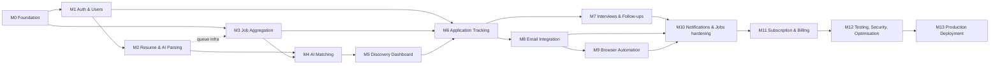

# Development Roadmap

> Each milestone is shippable and verifiable. A milestone is **COMPLETED** only when every acceptance criterion is verified (tests green in CI + manual checks recorded in `IMPLEMENTATION_STATUS.md`).
> Complexity scale (for ~1–2 engineers working with Claude Code agents): **S** ≤ 1 week · **M** 1–2 weeks · **L** 2–4 weeks · **XL** 4+ weeks.
> Agents: `architect`, `frontend-specialist`, `backend-specialist`, `database-architect`, `ai-engineer`, `automation-engineer`, `security-auditor`, `qa-engineer`, `code-reviewer` (`.claude/agents/`).

## Active profile: zero-cost (ADR-023): per-milestone changes
Where a milestone below mentions Redis/BullMQ, worker containers, object storage, Claude, Voyage, Resend or billing, this table wins:

| Milestone | Zero-cost changes |
|---|---|
| M0 | Docker Compose = Postgres + pgvector only. Build the `BackgroundJob` queue + `/api/cron/drain` + `after()` kick instead of a worker skeleton. Build the seams (`JobQueue`, `RateLimiter`, `FileStore`, `LlmProvider`, `EmbeddingProvider`, `Mailer`). Record free-tier limits in `docs/setup/free-tier-limits.md`. Configure cron-job.org. |
| M1 | Better Auth with **Google sign-in only**; no transactional email. Deletion purge runs from the daily maintenance job. |
| M2 | Files in `ResumeFile` (bytea). AI via `LlmProvider`: Gemini primary, Groq fallback, PII redaction. Parsing jobs on the DB queue. |
| M3 | Only free public sources (Greenhouse/Lever/Ashby board APIs, Remotive, Arbeitnow); ingest chunked per page; `raw` not stored; storage-budget pruning. Legacy Apify on the owner's free credit only. |
| M4 | Gemini embeddings, `halfvec(768)`. Explanations K ≤ 10/user/day; deterministic fallback when quota is exhausted. |
| M5–M7 | Unchanged except notifications/reminders are in-app only. |
| M8 | Gmail API only, OAuth app in Testing mode (explicit test users, weekly reconnect). No Microsoft, no reply tracking. Encryption key from env (no KMS). |
| M9 | Local automation runner on the owner's PC; owner-only feature. |
| M10 | Notification center in-app; the outbox is `BackgroundJob`; dead jobs on the admin page. No digests by email unless a free email channel is added. |
| **M11** | **Deferred:** no billing while on Vercel Hobby (non-commercial). |
| M12 | Free tooling only (ZAP, Semgrep CE, gitleaks, k6 OSS); load tests scaled to free-tier limits. |
| M13 | Deploy = Vercel Hobby + Neon Free + cron-job.org + Sentry free; `*.vercel.app` domain. |

## Dependency graph

Critical path: M0 → M1 → M2 → M4 → M5 → M6 → M8 → M9 → M10 → M11 → M12 → M13. In the zero-cost profile M11 is deferred, so M12 follows M10 directly. M3 can run in parallel with M1/M2 once M2's queue infrastructure lands (or M3 introduces it if started first).

---

## Milestone 0: Project Foundation
- **Objective:** a clean, reproducible, CI-verified baseline for v2 that still runs v1.
- **Features:** none user-facing.
- **Technical tasks:**
  1. `git init`, first commit of current tree (verify `.env.local` is ignored), branch protection on remote.
  2. `npm ci` (repair broken `node_modules`), confirm `npm run build`, `test`, `lint`, `typecheck` pass for v1; read `node_modules/next/dist/docs/` and record any convention changes in `.claude/skills/nextjs-app-router`.
  3. Restructure to `src/` per ADR-021; v1 code moved to `src/legacy/` + route files kept working; path alias `@/*` → `src/*`.
  4. TS strictness additions (`noUncheckedIndexedAccess`, `exactOptionalPropertyTypes`), ESLint boundaries (`no-restricted-imports` for `server/` from client, ban `sql.raw` with non-constant input and restrict `db` imports to `src/server/db/**` + repositories), Prettier.
  5. Drizzle v2 toolchain (ADR-004, ADR-024): `src/server/db/client.ts`, `src/server/db/schema/_shared.ts` (`pgSchema("app")`, id/timestamp helpers) + `index.ts` barrel, drizzle-kit config covering `public` + `app` (`schemaFilter`), first custom migration with the extensions, then the generated baseline (drizzle-kit emits `CREATE SCHEMA "app"`); local Docker Compose (Postgres+pgvector only in the zero-cost profile; scale adds Redis, MinIO).
  6. Env validation split (`src/server/lib/env.ts` web vs worker schemas); `.env.example` updated.
  7. Core libs: `AppError` + `ActionResult`, `authedAction`/`route` wrappers (port v1 `lib/api.ts`), pino logger with redaction, Sentry (web), request id in `proxy.ts`, security headers + CSP (report-only first).
  8. CI (GitHub Actions): install, lint, typecheck, unit tests, build, gitleaks, `npm audit --omit=dev` (fail on high).
  9. Background-job foundation: `BackgroundJob` queue (`SKIP LOCKED` claim, retries, `notBefore`), `/api/cron/drain` time-boxed runner (`DRAIN_TIME_BUDGET_MS = 20000`, summary returned within ~20 s because cron-job.org times out at 30 s), `after()` kick helper, cron-job.org schedule (every 30 min by default to protect Neon compute), and `docs/setup/free-tier-limits.md` (zero-cost profile; scale profile would add a BullMQ worker skeleton + Dockerfile).
  10. Provider seams with fakes: `LlmProvider` (Gemini, Groq), `EmbeddingProvider`, `FileStore` (Postgres), `RateLimiter` (Postgres), `Mailer` (no-op until M8).
- **Dependencies:** none open: ADR-004 (Drizzle) and ADR-024 (`app` schema) accepted 2026-11-04; ADR-008 replaced by ADR-023 (no worker host).
- **Responsible agents:** `architect` (lead), `backend-specialist`, `database-architect`, `qa-engineer`, `security-auditor` (headers/CI scanning review).
- **Deliverables:** restructured repo, CI pipeline, Docker Compose, Drizzle `app`-schema baseline migration, core libs, updated docs.
- **Acceptance criteria:** fresh clone → `docker compose up` + `npm ci` + `npm run dev` works with documented steps; CI green on main; v1 pages still function locally; v1's 34 tests pass from new locations; no secrets in git history (gitleaks clean).
- **Testing requirements:** existing Vitest suite; smoke test that legacy routes respond 200 (authed) / 307 (unauthed).
- **Estimated complexity:** **M**

## Milestone 1: Authentication and User Management
- **Objective:** real multi-user accounts with secure sessions and profiles.
- **Features:** sign-up/in (email + Google/Microsoft), email verification, password reset, sessions management, onboarding steps 1 & 3 (goals, preferences), profile settings, consent capture, account deletion (with grace period), app shell + navigation.
- **Technical tasks:** Better Auth + Drizzle adapter (`drizzleAdapter(db, { provider: "pg" })`, tables `app.users`/`app.sessions`/`app.accounts`/`app.verifications`, UUIDv7 ids); `User`, `Session`, `Account`, `Verification`, `UserProfile`, `UserConsent`, `AuditLog` migrations; `requireUser()`/`TenantContext`; transactional email provider + React Email templates; rate limiting (Redis) on auth; `(marketing)`, `(auth)`, `(app)` route groups; AppShell/Sidebar/Topbar; v1 password login retained only for `/legacy` behind owner flag; deletion purge job (runs synchronously via cron route until M2 queues exist).
- **Dependencies:** M0.
- **Responsible agents:** `backend-specialist` (lead), `frontend-specialist`, `database-architect`, `security-auditor` (mandatory review), `qa-engineer`.
- **Deliverables:** working auth flows, onboarding (without resume step), settings profile/security tabs.
- **Acceptance criteria:** all auth flows work end-to-end; sessions revocable; no user enumeration (verified by test); auth endpoints rate-limited; cross-tenant access tests pass for profile; deletion removes all user rows after grace period; security-auditor sign-off recorded.
- **Testing requirements:** unit (validators, authz helpers), integration (auth + profile services with DB), Playwright E2E (sign-up → verify (mail catcher) → onboarding → sign-out → sign-in → delete), axe checks on auth pages.
- **Estimated complexity:** **L**

## Milestone 2: Resume Upload and AI Parsing
- **Objective:** turn an uploaded resume into a verified, editable candidate profile.
- **Features:** resume library, upload (PDF/DOCX), parsing progress, review & correction screen, versions, primary resume, onboarding step 2 & 4.
- **Technical tasks:** object storage integration + presigned downloads; upload Route Handler with validation; **Redis + BullMQ infrastructure** (queue module, worker-general consumers, Bull Board for admins); text extraction (`unpdf`, `mammoth`); `src/server/ai/client.ts` (Anthropic SDK, usage metering, refusal handling); `resume.extract` prompt v1 + Zod schema + evidence verification; skill taxonomy seed + normaliser; experience analysis; `Resume`, `ResumeVersion`, `Skill`, `CandidateSkill`, `UsageRecord` migrations; Free-tier quota enforcement.
- **Dependencies:** M1; owner decision on free-tier AI data routing (ADR-023 *Provider data-routing*, OPEN) before resume parsing is enabled for anyone but the owner.
- **Responsible agents:** `ai-engineer` (lead for extraction), `backend-specialist` (upload, queues, storage), `frontend-specialist` (review UI), `database-architect`, `security-auditor` (upload + PII review), `qa-engineer` (eval set).
- **Deliverables:** end-to-end resume pipeline; eval dataset v1 (≥ 30 resumes) with baseline metrics recorded.
- **Acceptance criteria:** upload rejects wrong type/size/encrypted files; parsing completes p95 < 60 s; extraction eval: skill precision ≥ 0.90, recall ≥ 0.80, date accuracy ≥ 0.90, unverifiable-evidence rate < 2%; user edits persist across re-parse; no resume text in logs (verified by log-scrubber test); quota enforced.
- **Testing requirements:** unit (normaliser, experience calc, magic-byte checks), integration (worker processor with mocked Claude via recorded fixtures), AI eval run (manual trigger, results committed), E2E upload → review.
- **Estimated complexity:** **L**

## Milestone 3: Job Aggregation
- **Objective:** a continuously refreshed, deduplicated, enriched global job catalog from permitted sources.
- **Features:** admin sources page (create/enable/compliance status/run now/runs history), job catalog with parse status.
- **Technical tasks:** `JobSourceAdapter` interface (generalise v1 `JobSource`); adapters: Greenhouse board API, Lever postings API, Ashby postings API, one licensed aggregator; legacy Apify adapter ported (disabled, owner-only); port `lib/extract/*` + `prepareJob` + tests; company resolution; exact + fuzzy dedupe; `job.extract` prompt (Batches API path for backfills); `Company`, `JobSource`, `JobSourceRun`, `Job`, `JobSkill`, `JobApplyChannel` migrations; repeatable schedules; expiry maintenance job; HMAC webhook for legacy Apify (fix F1).
- **Dependencies:** M0 (M2 queue infra if available; otherwise M3 introduces it).
- **Responsible agents:** `backend-specialist` (lead), `ai-engineer` (job extraction), `database-architect`, `security-auditor` (source compliance & webhook review), `qa-engineer`.
- **Deliverables:** ≥ 3 approved sources ingesting on schedule; catalog of ≥ 5K active jobs in staging.
- **Acceptance criteria:** re-running an ingest produces zero duplicate jobs; duplicates across sources merged (≥ 90% on labelled duplicate set); job extraction eval: required-skill F1 ≥ 0.85, seniority accuracy ≥ 0.80; each enabled source has `complianceStatus=APPROVED` with review notes; run failures visible in admin UI.
- **Testing requirements:** fixture-based adapter tests (recorded API responses), v1 extraction tests ported, integration tests for upsert idempotency, eval run for job extraction.
- **Estimated complexity:** **L**

## Milestone 4: AI Job Matching
- **Objective:** transparent, explainable per-user match scores.
- **Features:** match scores, breakdown, strengths/gaps, missing-skills insights (visible via minimal UI until M5).
- **Technical tasks:** embeddings provider integration + model selection eval (records model/dimension in ADR-010); vector columns + HNSW index; `vector-repository.ts` raw SQL; hard filters; component scorers (pure functions, `scoringVersion 2026.1`); calibration of semantic range; LLM rerank/explain (`match.explain` prompt, prompt caching of candidate block); `JobMatch` migration; triggers (resume/profile change, schedule, on-demand); degraded mode without embeddings.
- **Dependencies:** M2, M3; embedding model fixed before M4 starts (`gemini-embedding-001` with manual L2 normalisation vs `gemini-embedding-2`; AI_MATCHING_DESIGN §4).
- **Responsible agents:** `ai-engineer` (lead), `database-architect` (vector indexing/perf), `backend-specialist` (orchestration), `qa-engineer` (ranking eval), `architect` (scoring review).
- **Deliverables:** matching pipeline, ranking eval dataset (≥ 20 profiles × 100 jobs labelled), scoring documentation in sync with `AI_MATCHING_DESIGN.md`.
- **Acceptance criteria:** NDCG@10 ≥ 0.75 on eval set; LLM adjustment does not reduce NDCG (A/B on eval); every `JobMatch` has a complete breakdown; deterministic scorer has 100% branch coverage; matching run p95 < 5 s per user at 50K active jobs; explanations' evidence verification active.
- **Testing requirements:** property-based tests for scorers (bounds, monotonicity: adding a matched required skill never lowers score), integration tests for vector queries, eval run committed.
- **Estimated complexity:** **XL**

## Milestone 5: Job Discovery Dashboard
- **Objective:** the daily-use discovery experience.
- **Features:** dashboard overview (matches, skills to boost), Discover feed with filters/search/split view, job details with match analysis, save/dismiss, saved jobs page, private job submission, AI feedback controls.
- **Technical tasks:** RSC data loaders with keyset pagination, URL-state filters, FTS search, `SavedJob` migration, mark-seen batching, `ScoreBadge/Ring/Breakdown`, `MatchCard`, empty/loading/error states, Suspense streaming, performance budgets.
- **Dependencies:** M4.
- **Responsible agents:** `frontend-specialist` (lead), `backend-specialist`, `qa-engineer`, `code-reviewer`.
- **Deliverables:** Discover, Job details, Saved, Dashboard v1.
- **Acceptance criteria:** Discover p95 server time < 300 ms at 100K jobs/1M matches (seeded perf DB); LCP < 2.5 s; filters shareable via URL; keyboard + screen-reader navigation verified (axe clean); dismiss reasons stored; mobile layouts per UI_UX §6.
- **Testing requirements:** component tests for score components, E2E discovery flows, axe, Lighthouse CI budget.
- **Estimated complexity:** **L**

## Milestone 6: Application Tracking System
- **Objective:** a complete candidate-side ATS and v1 parity for the owner.
- **Features:** Kanban (DnD + keyboard), list view + CSV export, application detail timeline, stage history, notes, contacts & contact logs, manual apply flow with answer sheet, apply-channel handling for WhatsApp / Google Form (v1 features), v1 data import.
- **Technical tasks:** `JobApplication`, `ApplicationStageChange`, `ApplicationDocument`, `Contact`, `ContactLog` migrations; stage state machine; fractional indexing; optimistic updates; import script (plain SQL from v1 `public.*` tables → v2 `app.*` tables for the owner account, ADR-024); **retire v1 UI** (delete `src/legacy/` UI after import verified).
- **Dependencies:** M1, M3, M5.
- **Responsible agents:** `frontend-specialist` (lead), `backend-specialist`, `database-architect` (import), `qa-engineer`, `code-reviewer`.
- **Deliverables:** tracker, timeline, import script + run log.
- **Acceptance criteria:** invalid stage transitions rejected; every stage change recorded; board order stable under concurrent moves (test); owner's v1 data imported with counts reconciled; v1 UI removed; cross-tenant tests for all new resources.
- **Testing requirements:** unit (state machine, fractional index), integration (services), E2E (Kanban DnD incl. keyboard), import dry-run test against a v1 fixture DB.
- **Estimated complexity:** **L**

## Milestone 7: Interview and Follow-up Management
- **Objective:** never miss an interview or follow-up.
- **Features:** interviews CRUD, .ics export, AI prep questions, follow-up reminders (create/snooze/complete, auto-suggestion), reminders surfaced on dashboard and `/follow-ups`, reminder emails via transactional provider.
- **Technical tasks:** `Interview`, `InterviewQuestion`, `FollowUpReminder` migrations; reminder scheduler (maintenance queue, `SKIP LOCKED`); timezone handling; `interview.questions` prompt.
- **Dependencies:** M6.
- **Responsible agents:** `backend-specialist` (lead), `frontend-specialist`, `ai-engineer` (prep questions), `qa-engineer`.
- **Deliverables:** interviews and follow-ups features.
- **Acceptance criteria:** reminders fire within 5 min of `dueAt` exactly once (concurrency test with 2 workers); DST/timezone tests pass; AI questions relevant on spot-check rubric (≥ 4/5 average on 20 samples).
- **Testing requirements:** scheduler integration tests with fake timers, E2E interview + reminder flow.
- **Estimated complexity:** **M**

## Milestone 8: Email Integration
- **Objective:** apply and follow up by email from the user's own mailbox, safely.
- **Features:** connect Gmail/Outlook (OAuth), templates, AI cover letters, draft preparation (v1 compose dialog evolved), approved bulk send with progress, recipient dedupe warnings, (optional) reply tracking → timeline.
- **Technical tasks:** OAuth flows with PKCE; envelope encryption + key rotation job; `EmailAccount`, `EmailMessage`, `MessageTemplate`, `WebhookEvent` migrations; `mail-send` queue with per-account limiter (port v1 queue semantics); double-send partial unique index; `coverLetter.generate` prompt + claim-verification; Google/Microsoft app verification submission; push webhooks if read scopes approved.
- **Dependencies:** M6 (applications), M1.
- **Responsible agents:** `backend-specialist` (lead), `security-auditor` (mandatory: OAuth, encryption), `ai-engineer` (cover letters), `frontend-specialist`, `qa-engineer`.
- **Deliverables:** email apply end-to-end; OAuth verification submitted (status tracked).
- **Acceptance criteria:** tokens never appear in logs/DB plaintext (test); revoked token → account `REAUTH_REQUIRED` and sends paused; no duplicate sends under retry/concurrency (test); daily caps enforced; cover letters contain no unverifiable claims on eval set (≤ 2% flagged); security sign-off.
- **Testing requirements:** provider APIs mocked with MSW; encryption unit tests (tamper detection, AAD mismatch); E2E with a test mailbox in staging (manual checklist).
- **Estimated complexity:** **L**

## Milestone 9: Browser Automation
- **Objective:** assisted applications on supported ATS forms with explicit approval.
- **Features:** "Fill application for me", review & approve screen, automation board, manual fallback answer sheet, admin adapter health.
- **Technical tasks:** `worker-automation` container (Playwright image), adapter interface + Greenhouse/Lever (M9a/b), Ashby/Workable (M9c); blocker detection; field detection + answer resolver + answer library; payload hashing; approval flow; verification; circuit breaker; artifacts storage + retention; `AutomationTask`, `AutomationExecution` migrations; compliance review doc per adapter.
- **Dependencies:** M8 (cover letters, consent patterns), M6.
- **Responsible agents:** `automation-engineer` (lead), `security-auditor` (mandatory), `backend-specialist`, `frontend-specialist`, `qa-engineer`.
- **Deliverables:** staged rollout per AUTOMATION_DESIGN §11.
- **Acceptance criteria:** CAPTCHA/MFA/login fixtures always yield `BLOCKED` (100%); submit never runs without matching approved hash (test); no auto-retry after submit click (test); ≥ 95% verified-submission rate over 200 controlled runs before GA; zero duplicates; artifacts purged after 90 days.
- **Testing requirements:** Playwright fixture-form suite per adapter, chaos tests (kill worker mid-run), manual smoke on owned test postings.
- **Estimated complexity:** **XL**

## Milestone 10: Notifications and Background Jobs (hardening)
- **Objective:** unify notifications and make background processing production-grade.
- **Features:** notification center (inbox, unread badge), preferences matrix, daily/weekly digests, "new matches" alerts.
- **Technical tasks:** `Notification`, `OutboxEvent` migrations; notification service (in-app + email per prefs; M7 reminder emails migrated onto it); transactional outbox relay; reconciliation cron for stale pending states; dead-letter queues + alerting; queue metrics in Sentry/Grafana; graceful shutdown for workers.
- **Dependencies:** M7, M8, M9.
- **Responsible agents:** `backend-specialist` (lead), `frontend-specialist`, `architect` (review), `qa-engineer`.
- **Deliverables:** notification center, outbox, ops dashboards.
- **Acceptance criteria:** no lost side effects when Redis is restarted mid-flow (chaos test); DLQ items visible with replay; digest respects preferences/timezones; unread count endpoint p95 < 50 ms.
- **Testing requirements:** integration tests for outbox relay, chaos tests, E2E preferences.
- **Estimated complexity:** **M**

## Milestone 11: Subscription and Billing
> **Deferred in the zero-cost profile (ADR-023).** Start only after moving web hosting off Vercel Hobby (commercial use) and resolving ADR-016.
- **Objective:** monetisation with reliable entitlement enforcement.
- **Features:** pricing page live, checkout, customer portal, plan limits with usage meters, upgrade prompts at limits, invoices.
- **Technical tasks:** billing provider decision (ADR-016) → `BillingProvider` implementation; `Subscription` migration; signed webhooks + `WebhookEvent` idempotency; entitlement service reading plan + usage; grace periods (PAST_DUE); tax/VAT via provider; PKR/PPP pricing if supported.
- **Dependencies:** M10 (notifications for billing events), all quota-bearing features.
- **Responsible agents:** `backend-specialist` (lead), `security-auditor`, `frontend-specialist`, `qa-engineer`.
- **Deliverables:** paid plans live in staging with test cards.
- **Acceptance criteria:** webhook replay/out-of-order events produce correct final state (test matrix); entitlements change within 60 s of payment; downgrade preserves data, only limits change; no paid feature reachable on Free (tests per gated action).
- **Testing requirements:** provider test-mode E2E, webhook fixture tests, entitlement unit tests.
- **Estimated complexity:** **M**

## Milestone 12: Testing, Security and Optimization
- **Objective:** launch readiness.
- **Features:** data export, admin 2FA enforcement, security log UI, ClamAV scanning, optional RLS.
- **Technical tasks:** penetration test (external or structured internal per OWASP WSTG); ZAP baseline in CI; dependency + container scanning; CSP enforce mode; load tests (k6) on Discover, actions, workers; query plan review & index tuning; bundle analysis; DPIA, privacy policy, terms, sub-processor list; analytics (consent-gated) if desired; backup restore drill.
- **Dependencies:** M11.
- **Responsible agents:** `security-auditor` (lead), `qa-engineer`, `database-architect`, `code-reviewer`, `architect`.
- **Deliverables:** security report with all High/Critical fixed, load-test report, restore-drill record, legal docs.
- **Acceptance criteria:** zero open High/Critical findings; NFR targets in PROJECT_OVERVIEW §7 met under load (10K users simulated); restore from backup < 1 h verified; coverage ≥ 80% on `src/server/modules`.
- **Testing requirements:** full regression suite, security tests, performance tests, AI eval regression gate.
- **Estimated complexity:** **L**

## Milestone 13: Production Deployment
- **Objective:** go live and operate safely.
- **Features:** public launch.
- **Technical tasks:** production infra (Vercel prod, worker host prod, Neon prod with PITR, Redis prod, storage prod, KMS), DNS/TLS/HSTS, secrets rotation, migration release step, monitoring & alert routing, status page, runbooks (incident response, key rotation, adapter disable, source disable), on-call rota, beta → GA rollout with feature flags, post-launch review.
- **Dependencies:** M12.
- **Responsible agents:** `architect` (lead), `backend-specialist`, `security-auditor`, `qa-engineer`.
- **Deliverables:** production environment, runbooks in `docs/guides/`, launch checklist signed.
- **Acceptance criteria:** smoke tests pass in prod; alerts fire on synthetic failures; rollback rehearsed; 7 days of beta with error rate < 1% of requests and no Sev-1 incidents.
- **Testing requirements:** production smoke suite (read-only + test account), synthetic monitoring.
- **Estimated complexity:** **M**

---

## Cross-milestone rules
1. Each milestone starts with an `architect` review of the relevant plan docs; deviations become ADR updates **before** code.
2. `security-auditor` review is mandatory for M1, M2, M8, M9, M11, M12 and any change touching auth, tokens, uploads, or automation.
3. `code-reviewer` reviews every PR; `qa-engineer` owns the test plan per milestone.
4. After each milestone: update `IMPLEMENTATION_STATUS.md` (with verification evidence), `TECHNICAL_DECISIONS.md` if needed, and `docs/`.
