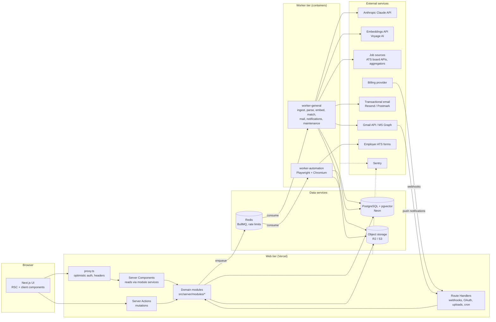
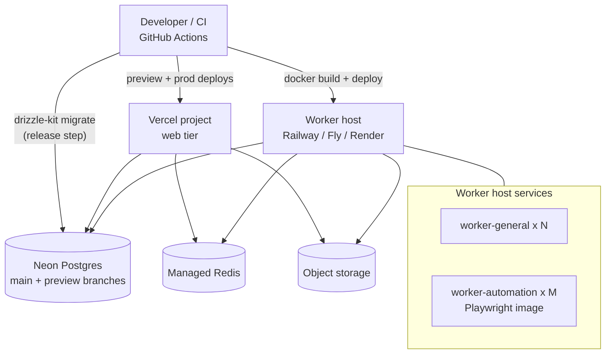
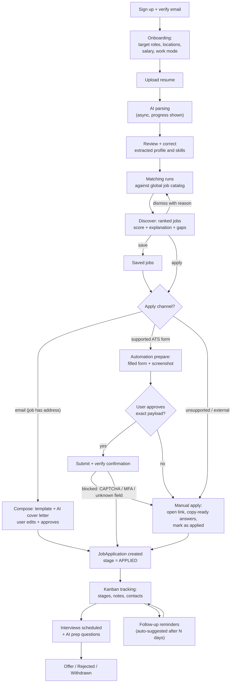
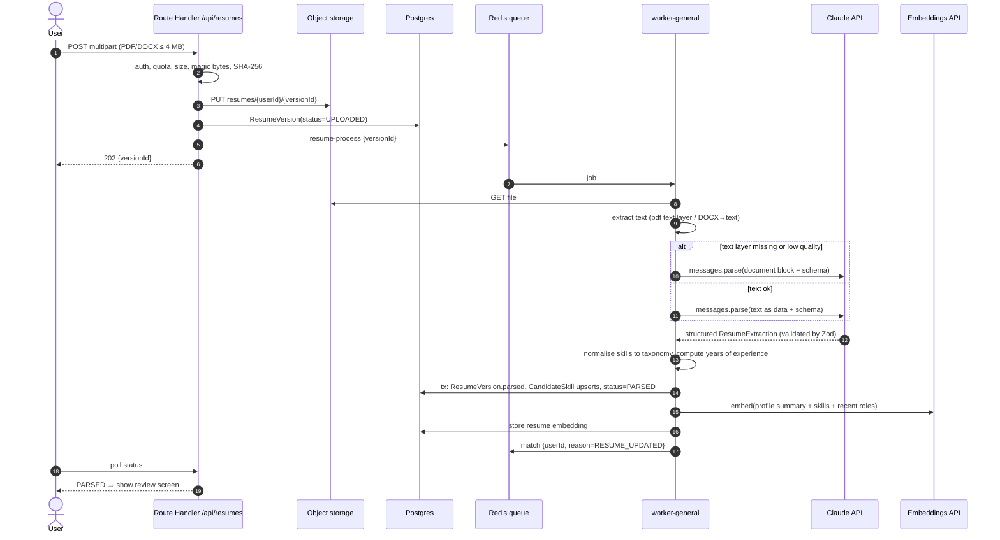
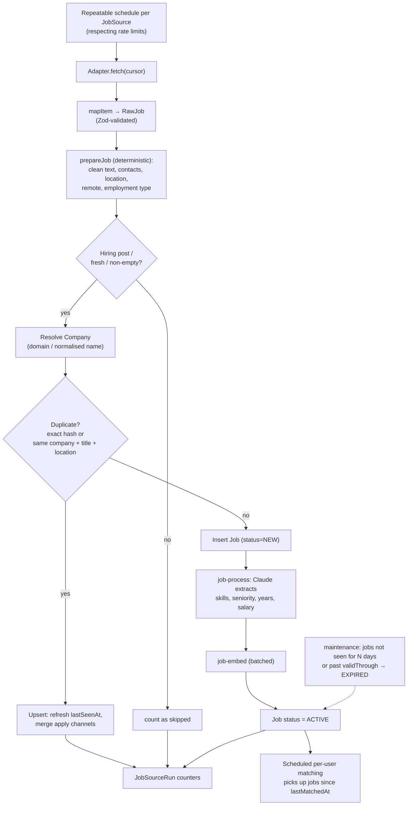
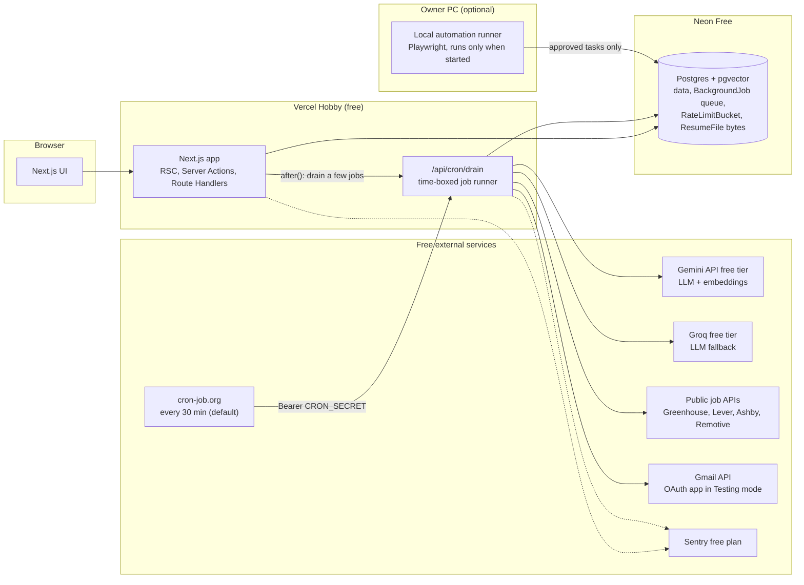

# System Architecture

> Companion docs: `TECHNICAL_DECISIONS.md` (why), `DATABASE_DESIGN.md` (data), `API_DESIGN.md` (contracts), `AI_MATCHING_DESIGN.md`, `AUTOMATION_DESIGN.md`, `SECURITY_DESIGN.md`.
>
> **Active profile: zero-cost (ADR-023). Read §8 first.** Sections 2–7 describe the scale profile. Their logical components (modules, queues, workflows) are identical in both profiles; only the infrastructure underneath changes, as mapped in §8.

## 1. Architectural style

A **modular monolith** (one Next.js app, domain modules with enforced boundaries) plus **two worker deployments** that consume background queues. A single PostgreSQL database is the system of record; Redis carries queues, rate-limit counters and short-lived cache; object storage holds files.

Principles:
1. **Request path does no slow work.** Anything over ~1 s or involving a third party that can fail (LLM, embeddings, ATS sites, mail providers, job feeds) is enqueued.
2. **Global catalog, per-user overlay.** Jobs/companies are shared and processed once; matches, applications and everything else are per user (ADR-006).
3. **Idempotent workers.** Every job handler can be retried safely: natural keys, upserts, state machines with guarded transitions.
4. **Deterministic first, AI second.** Regex/parsers/rules extract what they can; LLMs fill gaps and explain; LLMs never own a decision with money, submission or score consequences (ADR-013, ADR-014).
5. **Humans approve irreversible actions.** Sending email as the user and submitting applications always require explicit approval.

## 2. High-level system architecture



## 3. Components

### 3.1 Frontend (Next.js App Router)
- **Route groups:** `(marketing)` public, statically rendered/cached; `(auth)` sign-in/up/verify/reset; `(app)` authenticated shell. Route Handlers under `app/api/`.
- **Rendering:** Server Components fetch through module services (no internal REST hop). User-private data is rendered dynamically inside `<Suspense>` boundaries; only global data (marketing, public company pages, taxonomy) uses `"use cache"` with `cacheTag`.
- **Mutations:** Server Actions in `src/features/<feature>/actions.ts`, returning a typed `ActionResult`. UI uses `useActionState`/`useOptimistic`. After mutation: `updateTag()` for read-your-writes on cached tags, or `refresh()` / `revalidatePath()` for dynamic pages (verify API names against the installed Next docs).
- **Client state:** URL search params for filters/sorting/pagination (shareable, server-readable); no global client store. Live progress (resume parsing, automation runs) via short polling of a Route Handler (SSE optional later).
- See `UI_UX_DESIGN.md` for layouts and components.

### 3.2 Backend (inside the web tier)
- **`proxy.ts`:** optimistic session-cookie presence check + redirects, security headers, request id. **Not** an authorization boundary; every action/handler re-verifies the session (as v1 does).
- **Domain modules** (`src/server/modules/<domain>`): `service.ts` (use cases, transactions, authorization), `repository.ts` (Drizzle queries, always tenant-scoped), `schemas.ts` (Zod), `index.ts` (public API). Modules are framework-agnostic so workers reuse them.
- **Authorization:** `requireUser()` → `TenantContext { userId, plan, roles }` passed explicitly into services. Admin operations require `role = ADMIN` and are audited.
- **Error model:** typed `AppError(code, message, details)` mapped to `ActionResult` / HTTP status in one place (pattern from v1 `lib/api.ts`), with internal messages never leaked on 500s.

### 3.3 Authentication
Better Auth (ADR-005): email/password + verification, Google/Microsoft OAuth sign-in, database sessions (httpOnly, `Secure`, `SameSite=Lax` cookie), session rotation on privilege change, optional TOTP. Separate from **mailbox OAuth connections** (`EmailAccount`), which request mail scopes only when the user connects a mailbox (incremental consent).

### 3.4 AI services (`src/server/ai`)
- `client.ts`: single Anthropic client (timeouts, retries=2, typed error mapping, refusal handling, usage metering → `UsageRecord`).
- `prompts/<task>/v<N>.ts`: versioned prompt + Zod output schema + model/effort config. Tasks: `resume.extract`, `job.extract`, `match.explain`, `coverLetter.generate`, `interview.questions`, `answer.formField`.
- `embeddings.ts`: provider wrapper (Voyage AI), batched, dimension asserted.
- Untrusted text (resumes, job descriptions, web pages) is always passed as clearly delimited data, never concatenated into instructions (`SECURITY_DESIGN.md` §11).

### 3.5 Job aggregation (`sources` + `catalog` modules)
Adapters implement `JobSourceAdapter { fetch(cursor) → AsyncIterable<RawJob>; mapItem(); rateLimit; compliance }` generalising v1's `JobSource`. Sync-pull adapters (ATS board APIs) run as repeatable jobs; async adapters (Apify, legacy) keep v1's start → webhook → collect + cron-fallback flow. Normalisation and dedupe reuse v1 `prepareJob`/`dedupeHash`, extended with company resolution and fuzzy duplicate detection (§5).

### 3.6 Resume processing (`resume` module)
Upload → validate → store → `resume.parse` job → text extraction (PDF text layer / DOCX→text; PDF document block fallback) → Claude structured extraction → normalisation into `CandidateSkill`, experience, education → embedding → triggers re-match. See §4.2.

### 3.7 Automation engine (`automation` module + `worker-automation`)
Two-phase prepare/approve/submit with per-ATS adapters; artifacts (screenshots, DOM snapshots of the filled form, confirmation page) in object storage. See `AUTOMATION_DESIGN.md`.

### 3.8 Email services (`mail` module)
- Outbound application email through the user's connected Gmail/Outlook (OAuth), queued with per-account rate limits and daily caps (v1's `MAIL_DAILY_LIMIT` concept, now per account and per plan).
- Double-send protection: unique constraint on `(userId, jobId, channel, recipient)` for active/sent states (v1 partial-index pattern).
- Inbound (optional, scope-dependent): provider push → `mail.sync` job → thread matching by `Message-ID`/`threadId` → `ContactLog` + application stage suggestion (never auto-moved without a rule the user enabled).
- System email via transactional provider with templates (React Email).

### 3.9 Background jobs (`src/server/jobs`, `src/workers`)

| Queue | Producer | Consumer | Concurrency / limits | Retries |
|---|---|---|---|---|
| `ingest` | repeatable schedules, admin "run now", webhooks | worker-general | 2; per-source rate limit | 5, exp backoff |
| `job-process` | ingest | worker-general | 8; Claude rate-limit aware | 3 |
| `job-embed` | job-process | worker-general | batched 64 | 5 |
| `resume-process` | upload action | worker-general | 4 | 3 |
| `match` | resume/profile change, schedule, new-jobs fan-out | worker-general | 4 | 3 |
| `match-explain` | match (top-K) | worker-general | 4 | 2 |
| `mail-send` | approved send action | worker-general | per-account limiter (e.g. 1 msg / 4 s, daily cap) | 3 (non-retryable on 4xx auth) |
| `mail-sync` | provider push, schedule | worker-general | 2 | 5 |
| `automation-prepare` / `automation-submit` | user actions | worker-automation | 2 per container; per-ATS-domain limiter | prepare 2, submit **0 automatic** (see Automation §8) |
| `notify` | any module | worker-general | 8 | 5 |
| `maintenance` | repeatable | worker-general | 1 | 3 |

Payloads are Zod-validated on both ends and carry only ids (never PII blobs). Job ids are deterministic where duplicates must collapse (e.g. `match:{userId}:{date}`).

### 3.10 Database
PostgreSQL 16+ with `pgvector`, `pg_trgm`, `citext`. Drizzle ORM (ADR-004) with the query builder for CRUD and the parameterised `sql` template for `SKIP LOCKED` claims and reporting aggregates; vector search uses Drizzle's native `halfvec` type and `cosineDistance`. v2 tables live in Postgres schema `app`, next to v1's `public` tables until the M6 import (ADR-024). Details: `DATABASE_DESIGN.md`.

### 3.11 External integrations

| Integration | Purpose | Auth | Failure mode |
|---|---|---|---|
| Anthropic API | extraction, explanations, generation | API key (server only) | retry 429/5xx; mark job `PARSE_FAILED` after retries; UI degrades to deterministic data |
| Voyage AI | embeddings | API key | retry; matching falls back to keyword-only scores flagged `degraded` |
| ATS job-board APIs | job ingestion | none/public or partner key | per-source backoff; source health on admin page |
| Gmail API / MS Graph | send/read mail as user | OAuth 2.0 (PKCE), encrypted refresh token | token revoked → `EmailAccount.status = REAUTH_REQUIRED`, notify user |
| Transactional email | system mail | API key | retry; fall back to in-app notification |
| Billing provider | subscriptions | API key + signed webhooks | webhook replay is idempotent by event id |
| Object storage | files | access key / IAM | upload fails → action error; no orphan DB rows (write DB after storage put) |
| Sentry | observability | DSN | non-blocking |

### 3.12 Deployment infrastructure



Environments: `local` (Docker Compose for Postgres+pgvector, Redis, MinIO), `preview` (per-PR Vercel deploy + Neon branch, shared staging Redis with key prefix), `staging`, `production`. Migrations run once per release before new code serves traffic (expand → migrate → contract pattern for breaking changes).

## 4. Key workflows

### 4.1 End-to-end application workflow (user journey)



### 4.2 AI processing workflow (resume)



### 4.3 Job discovery workflow



### 4.4 Application automation workflow

```mermaid
sequenceDiagram
  autonumber
  actor U as User
  participant SA as Server Action
  participant DB as Postgres
  participant Q as Queue
  participant WA as worker-automation
  participant ATS as Employer ATS form
  participant OS as Object storage

  U->>SA: startAutomation(jobId)
  SA->>DB: check plan quota, adapter support, consent
  SA->>DB: AutomationTask(status=PREPARING)
  SA->>Q: automation-prepare {taskId}
  Q->>WA: job
  WA->>ATS: open apply URL (robots/terms allowlisted domain)
  WA->>WA: detect fields (adapter map + generic heuristics)
  WA->>WA: answer from profile; unknown questions → AI draft (flagged)
  WA->>ATS: fill fields, attach resume (do NOT submit)
  WA->>OS: screenshots + filled-field snapshot
  WA->>DB: AutomationExecution(PREPARED, payload hash), Task=AWAITING_APPROVAL
  DB-->>U: notification "Review your application"
  U->>SA: approve(taskId, payloadHash) or edit answers
  SA->>DB: Task=APPROVED (approvedAt, approvedPayloadHash)
  SA->>Q: automation-submit {taskId}
  Q->>WA: job
  WA->>ATS: fresh session, refill exactly the approved payload
  alt CAPTCHA / MFA / bot challenge / form changed
    WA->>DB: Task=NEEDS_MANUAL (reason) + copy-ready answers
  else form matches approved payload
    WA->>ATS: submit
    WA->>WA: verify confirmation (URL/text/email receipt)
    WA->>OS: confirmation screenshot
    WA->>DB: Task=SUBMITTED, JobApplication stage=APPLIED
  end
  DB-->>U: result notification
```

## 5. Communication between components

| From → To | Mechanism | Contract |
|---|---|---|
| Browser → web | HTTPS: RSC payloads, Server Action POSTs, Route Handler JSON | `API_DESIGN.md` |
| Web modules → DB | Drizzle over the pooled Neon URL (`drizzle-orm/neon-serverless`) | tenant-scoped repositories; schema `app` |
| Web → workers | BullMQ enqueue (Redis) | Zod payload schemas in `src/server/jobs/payloads.ts`; payloads carry ids only |
| Workers → web/UI | DB state + `Notification` rows; UI polls/refreshes | status enums with guarded transitions |
| External → web | Signed webhooks (billing, mail push, Apify legacy) | signature verified, event-id idempotency table |
| Workers → externals | SDKs / HTTP with timeouts, retries, circuit-breaking per host | adapter interfaces |
| Cross-module (sync) | function calls via module `index.ts` | no repository imports across modules |
| Cross-module (async) | queue jobs; later transactional outbox (ADR-007) | `OutboxEvent` |

## 6. Scalability notes

- **Expected launch envelope:** 1–10K users, 50–200K active jobs, ~10K new jobs/day. A single Postgres instance with HNSW indexes and the pooled driver is sufficient; workers scale horizontally.
- **Matching cost** grows with `users × new jobs`. Bounded by: hard-filter SQL before ANN, ANN `LIMIT k`, only scoring jobs newer than `lastMatchedAt`, LLM only for top-K per user per day.
- **Hot paths** get covering indexes (§DB 6) and are load-tested in M12 (`TESTING_STRATEGY.md` §8).
- **Escape hatches:** read replica for analytics; partition `JobMatch` and `UsageRecord` by month; move vectors to a dedicated store only on measured need.

## 7. Failure handling summary

| Failure | Behaviour |
|---|---|
| LLM unavailable / refusal | job stays `PARSE_PENDING` and retries; resume shows "parsing delayed"; deterministic fields still displayed |
| Embeddings unavailable | matching runs keyword-only, `JobMatch.degraded = true`, recomputed later |
| Worker crash mid-job | BullMQ stalled-job recovery; handlers idempotent |
| Redis outage | actions that enqueue return `SERVICE_UNAVAILABLE`; reconciliation cron re-enqueues from DB state (`status=*_PENDING` older than N minutes) |
| Mail token revoked | account → `REAUTH_REQUIRED`, queued sends paused, user notified |
| ATS form changed | automation → `NEEDS_MANUAL`, adapter health metric increments, alert at threshold |

## 8. Zero-cost deployment profile (ACTIVE, ADR-023)

### 8.1 Topology



### 8.2 How background work runs without workers
1. A service enqueues a `BackgroundJob` row **inside the same transaction** as the state change (this doubles as the transactional outbox).
2. The action schedules `after(() => drain({ budgetMs: 20_000 }))` so short jobs (e.g. resume parse) usually start within seconds of the request. Verify `after()` semantics and Hobby function limits in the installed Next.js/Vercel docs.
3. **cron-job.org** calls `GET /api/cron/drain` **every 30 minutes by default** (configurable in the cron-job.org job) with `Authorization: Bearer CRON_SECRET`; Vercel's once-a-day cron is a backstop. The interval is long on purpose. Neon suspends compute only after **5 idle minutes**, and every call wakes it. A 10-minute drain would keep the database awake about half the time and could use up the free compute allowance, which v1, v2 and the dev branch share (ADR-023 *Neon compute budget*). User-triggered work therefore relies on the `after()` kick in step 2; the cron only picks up deferred, retried and bulk work. When nothing is due, the drain exits after one indexed query.
4. `drain()` claims jobs with `FOR UPDATE SKIP LOCKED` ordered by `priority, notBefore` and runs handlers until **`DRAIN_TIME_BUDGET_MS` (20 000 ms)** has elapsed. It then returns its summary (`{ processed, remaining, deferred }`). cron-job.org times out after **30 s** and disables a job after **more than 25 consecutive failures**, so the response must always arrive within ~20 s. If work remains, the handler may continue with `after(() => drain({ budgetMs }))`, staying inside the Vercel function duration limit; that continuation never delays the response. Unfinished work stays queued. The handler should also catch its own errors and still return 200 with a summary, so that a single bad job never counts as a cron failure.
5. Long tasks are **chunked**: ingest processes one page of a source per job and enqueues the next page; matching scores ≤ 200 candidates per job; embedding batches ≤ provider batch limit.
6. Failures: `attempts++`, exponential `notBefore` backoff, `DEAD` after `maxAttempts` (visible on the admin page). Stale `RUNNING` rows (> 5 min) are reset by the maintenance job.
7. AI budget exhausted → the job is re-queued with `notBefore` = next quota reset; the UI shows deterministic results meanwhile.

### 8.3 Queue mapping
| Logical queue (§3.9) | Zero-cost implementation | Typical latency |
|---|---|---|
| `resume-process` | BackgroundJob, priority 10, `after()` kick | seconds–1 min |
| `ingest`, `job-process`, `job-embed` | BackgroundJob, priority 100, cron-driven, chunked | 30–60 min (one chunk per 30-min drain, plus `after()` continuations) |
| `match`, `match-explain` | BackgroundJob, priority 50, dedupe key per user/day; `after()` kick when user-triggered | seconds–minutes when kicked, otherwise next drain (≤ 30 min) |
| `mail-send` | BackgroundJob, priority 20, per-account spacing via `notBefore` | first send on the `after()` kick; spaced sends go out on later drains (≤ 30 min apart) |
| `notify`, `maintenance` | BackgroundJob; maintenance runs once per day from the Vercel cron | hours |
| `automation-prepare/submit` | `AutomationTask` rows picked up by the **local runner** on the owner's PC | when the runner is on |

### 8.4 Profile-independent seams (must exist from M0)
`JobQueue` (enqueue/claim/complete/fail), `RateLimiter`, `FileStore`, `LlmProvider`, `EmbeddingProvider`, `Mailer`. Zero-cost adapters: Postgres queue, Postgres rate limiter, Postgres file store, Gemini + Groq, Gemini embeddings, Gmail API. Scale adapters (BullMQ, Redis, R2/S3, Claude, Voyage, Resend) can be added later without touching domain modules.

### 8.5 Limits to respect (verify current numbers in M0, record them in `docs/setup/free-tier-limits.md`)
- Vercel Hobby: non-commercial use; cron frequency; function max duration; monthly invocations/bandwidth.
- Neon Free: storage **1 GB per project** (writes blocked when full; budget kept conservative, alert at 70%), compute **100 CU-hours/month per project shared by all branches**, auto-suspend after 5 idle minutes → storage and compute budgets in ADR-023.
- cron-job.org: 30 s request timeout; job auto-disabled after more than 25 consecutive failures → drain budget 20 s, 30-min default interval.
- Gemini/Groq: requests per minute/day and tokens per minute per model → daily budgets in config.
- Gmail API Testing mode: explicit test users; ~7-day refresh-token lifetime.
